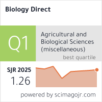
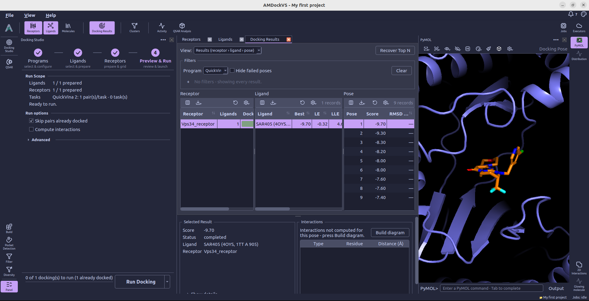
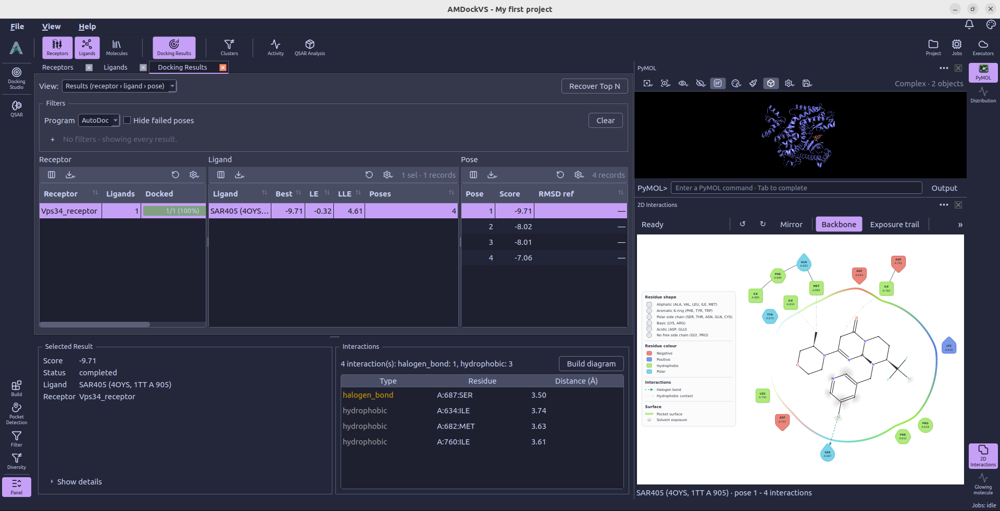
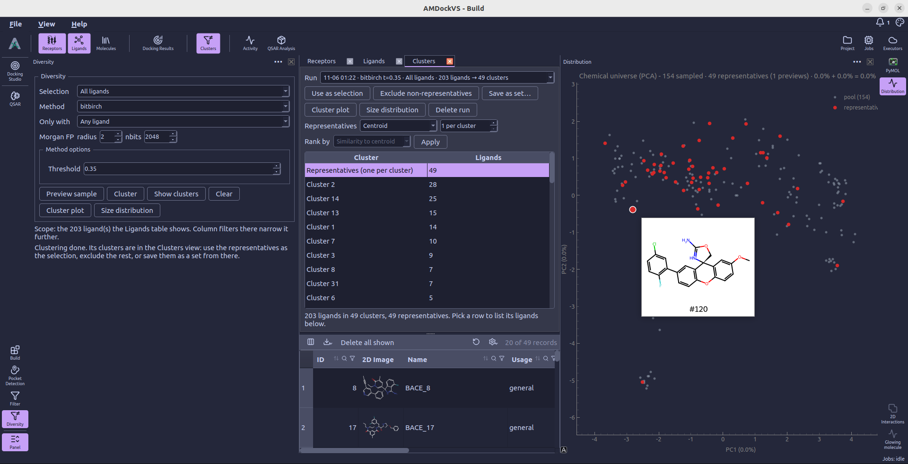
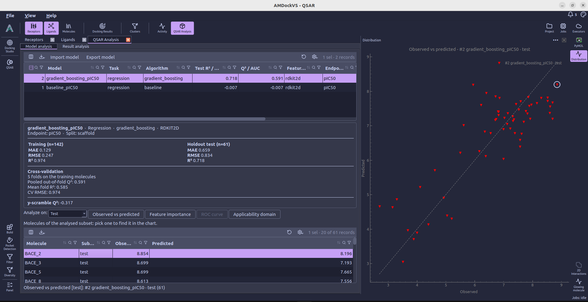

<p align="center">
  
</p>

<h1 align="center">AMDockVS</h1>

<p align="center"><strong>From molecules to docking results, in one workspace.</strong></p>

<p align="center">
  <a href="https://amdockvs.github.io/AMDockVS/latest/">Documentation</a> ·
  <a href="https://amdockvs.github.io/AMDockVS/latest/overview/#tutorial">First docking tutorial</a> ·
  <a href="https://amdockvs.github.io/AMDockVS/latest/runtime_api/">Python API</a> ·
  <a href="https://github.com/AMDockVS/AMDockVS/issues">Report an issue</a>
</p>

AMDockVS is a desktop application and Python API for molecular docking and virtual
screening. Prepare structures, explore compound libraries, run docking, and inspect
poses and interactions. Each project keeps your molecules, settings, jobs, and
results together.

## Cite us

<a href="https://www.scimagojr.com/journalsearch.php?q=5800173376&amp;tip=sid&amp;exact=no" title="SCImago Journal &amp; Country Rank"></a>

If you use AMDock or AMDockVS in your research, please cite the original paper:

Valdés-Tresanco, M.S., Valdés-Tresanco, M.E., Valiente, P.A. and Moreno E.
**AMDock: a versatile graphical tool for assisting molecular docking with Autodock
Vina and Autodock4**. _Biology Direct_, 2020 15, 12.
[https://doi.org/10.1186/s13062-020-00267-2](https://doi.org/10.1186/s13062-020-00267-2)

<br clear="right">

## What you can do

Use the desktop interface for interactive work or the
[Python API](https://amdockvs.github.io/AMDockVS/latest/runtime_api/) to:

- **Prepare your molecules.** Import receptors and ligands, generate 3D structures,
  and prepare docking inputs.
- **Shape your screening library.** Filter compounds by molecular properties,
  cluster similar molecules, and select representatives.
- **Find where to dock.** Predict candidate pockets with P2Rank or define a search
  box around a reference ligand.
- **Run docking.** Use AutoDock Vina, QuickVina 2, gnina, AutoDock-GPU, or Uni-Dock
  through Docking Studio, with background job monitoring.
- **Inspect your results.** Browse scores and poses, view complexes in PyMOL, and
  explore protein–ligand contacts in 2D.
- **Work with activity data.** Train and evaluate QSAR models, then predict
  activities for other compounds.



Job execution in AMDockVS is powered by [MolSuite](https://molsuite.github.io/).

## Get started

With [micromamba](https://mamba.readthedocs.io/en/latest/installation/micromamba-installation.html#linux-and-macos)
installed:

```bash
curl -LO https://raw.githubusercontent.com/AMDockVS/AMDockVS/main/environment.yml
micromamba create -n amdockvs -f environment.yml
micromamba activate amdockvs
amdockvs
```

Using conda? Replace the create and activate commands with
`conda env create -f environment.yml` and `conda activate amdockvs`.

On the welcome screen, choose **Your first docking** to work through the included
Vps34–SAR405 example, from importing molecules to submitting a docking run.
[Watch the walkthrough](https://www.youtube.com/watch?v=HjT4PxUy0yg).

<details>
<summary>Optional features and installation details</summary>

Install all optional Python dependencies, or select the features you need:

```bash
pip install "AMDockVS[all]"
# Individual extras: bblean, pockets, qsar
```

- `bblean`: BitBIRCH clustering through its command-line tool.
- `pockets`: the Java runtime used by P2Rank.
- `qsar`: scikit-learn for model training and prediction.

Additional programs can be installed from **Settings → External tools**.
Availability depends on the operating system and hardware; some docking engines
require a compatible GPU. See the
[Docking Studio guide](https://amdockvs.github.io/AMDockVS/latest/docking_studio/) for
program requirements.

The environment combines conda-forge and pip packages. To change its conda
dependencies, edit `environment.yml` and recreate the environment instead of
installing conda packages into it afterwards.

For an existing Python environment, `pip install AMDockVS` is also available.
AMDockVS requires Python 3.12 or newer; Vina can be installed through the
application's Programs step.

</details>

## A closer look

### Run docking and inspect poses

[Docking Studio guide](https://amdockvs.github.io/AMDockVS/latest/docking_studio/)

Choose a docking engine, prepare ligands and receptors, define the search box,
and launch a run in Docking Studio. Browse ranked poses alongside their 3D
structures and 2D interaction diagrams.



### Explore chemical diversity

[Diversity guide](https://amdockvs.github.io/AMDockVS/latest/diversity/)

Group similar compounds, inspect their distribution, and choose representatives
for your next screening run.



### Connect structures with activity

[QSAR guide](https://amdockvs.github.io/AMDockVS/latest/qsar/)

Build QSAR models from measured activities and inspect model performance,
predictions, and applicability to new compounds.



## License

Released under the [MIT License](https://github.com/AMDockVS/AMDockVS/blob/main/LICENSE).
