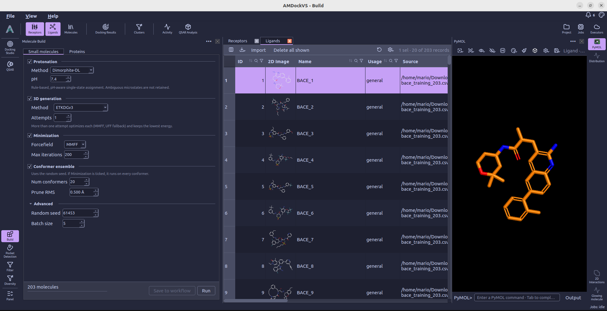
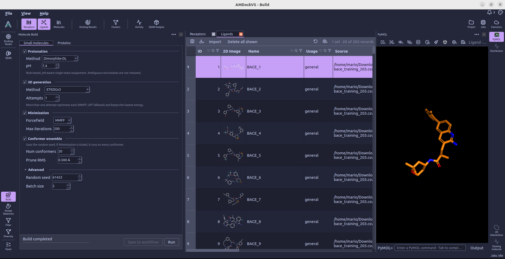
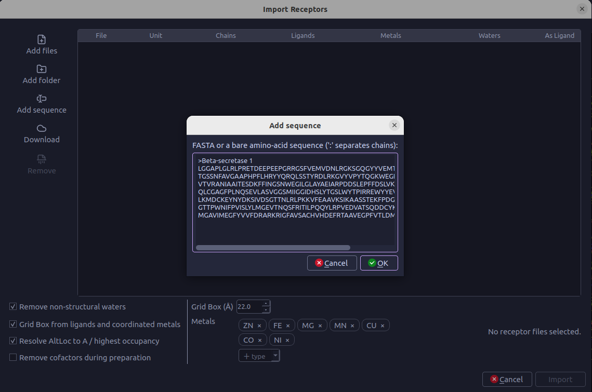
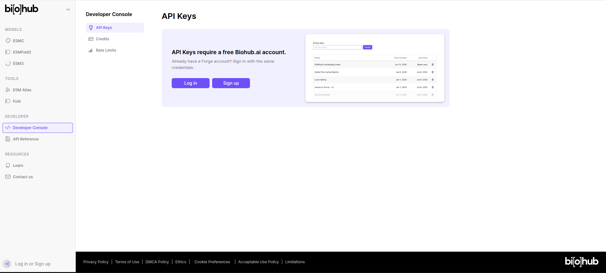
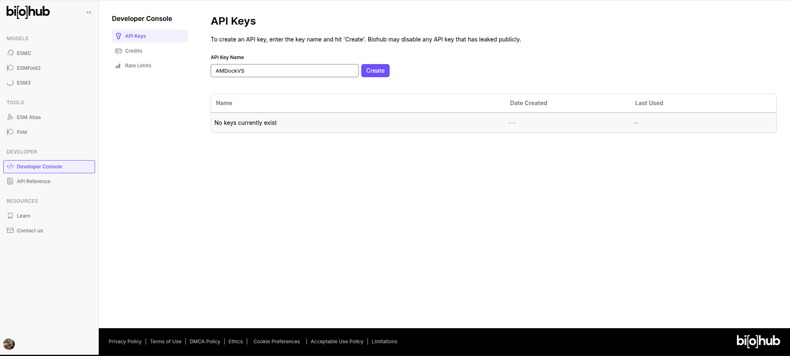
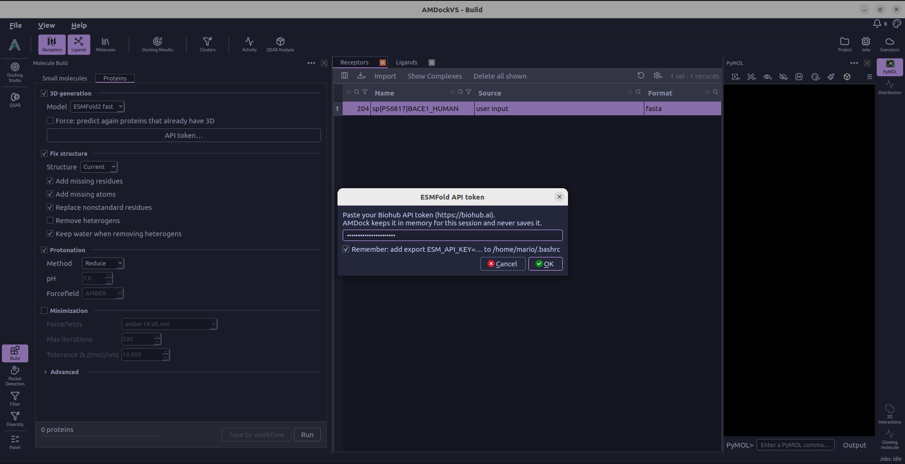
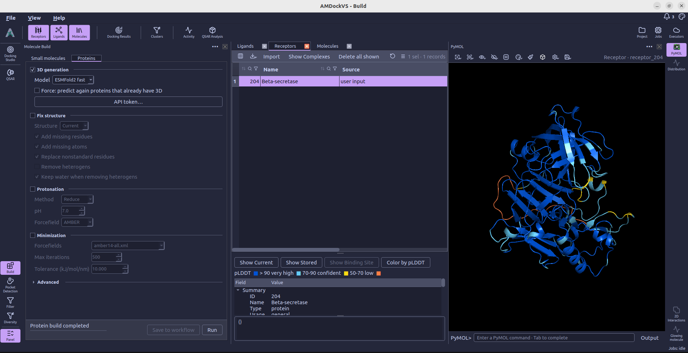

#  Build

**Build** prepares small molecules and proteins already imported into the
project. Open it from the left tool rail, choose a molecule type, and enable
the operations you want to run. The central Molecules table shows the scope
being prepared; table filters and the global ligand or receptor selection
narrow that scope.

Use Build to change molecular structures before docking or other analyses.
Program-specific docking preparation is configured separately in
[Docking Studio](docking_studio.md).

## 1. Choose the molecules

Select **Small molecules** or **Proteins**. The Molecules table switches to
that type, and the action bar summarizes the number of molecules in scope.
Review that count before starting a run.

For a project with a screening library, **Ligands from** lets you choose
project rows, screening shards, or both. Conformer ensembles apply to project
rows; they are not generated for molecules kept in shards.

## 2. Prepare small molecules

Tick the sections to include in the build. Enabled operations run in this
order: protonation, 3D generation, conformer generation, then minimization.
Minimization is displayed before the conformer controls in the panel, but runs
after conformer generation when both are enabled.

### Protonation

Choose a method and, for methods that predict protonation states, a **pH**:

- **Dimorphite-DL** assigns a single pH-dependent state using protonation rules.
- **OpenBabel** performs pH-dependent protonation through its command-line tool.
- **pKasso** selects the most probable state at the chosen pH. Choose
  **MolGpKa (fast)** or **MolGpKa + Uni-pKa (precise)**, set the thread count,
  and optionally request a GPU for the mixed model.
- **Explicit Hs (RDKit)** adds hydrogens while preserving the current charge
  states. The pH control is disabled for this method.

These operations retain one state per molecule rather than adding separate
records for alternative protonation microstates. OpenBabel and pKasso report
their runtime availability in the panel; install missing runtimes through
**Settings → External tools**.

### 3D generation

Choose **ETKDGv3** or **srETKDGv3 (small rings)** and set **Attempts**. Missing
hydrogens are added during embedding. With multiple attempts, each candidate
is optimized using MMFF, with UFF as a fallback, and the lowest-energy
candidate is retained.

### Conformer ensemble

Set **Num conformers** and **Prune RMS** to generate an ensemble and remove
similar conformers. This step uses the random seed from **Advanced**. If
Minimization is also enabled, it applies to every conformer, with another
pruning pass after optimization.

### Minimization

Choose **MMFF** or **UFF** and set **Max iterations**. Enable this section when
you want geometry optimization as part of the build, including optimization
of a conformer ensemble.

## 3. Prepare proteins

In the **Proteins** tab, enable the operations needed for the structures in
scope. The run performs them in the following order.

### 3D generation

In the receptors tab, users can import one or more sequences in fasta format using the **Add sequence** button or import from Uniprot using **Download**.

Users can then predict a structure from its sequence using **ESMFold2 fast** or **ESMFold2** models. The **ESMFold2 fast** option is a faster, lower-accuracy version of the full ESMFold2 model. The **ESMFold2** option uses the full model for higher accuracy predictions. This optional step uses an external service and requires an API token, entered
through **API token...**. Enable **Force: predict again proteins that already
have 3D** to replace an existing model with a new prediction. Below are the steps to obtain an API token from Biohub.ai:

1. Open [Biohub Developer Console](https://biohub.ai/developer-console/api-keys)
    and choose **Sign up** to create a free account or **Log in** if you
    already have one.

    

2. After signing in, enter a descriptive **API Key Name**, such as
    `AMDockVS`, and select **Create**. Copy the generated API token.

    

3. In AMDockVS, open **Build → Proteins → 3D generation → API token...**,
    paste the token, and select **OK**. Leave **Remember** unchecked to use
    it only for the current session. Enable **Remember** to save it in your
    shell profile (or user environment on Windows) for future sessions.

    

Having a valid API token, we can now predict the 3D structure of a protein from its sequence. Select **ESMFold2 fast** or **ESMFold2** and click **Run** to start the prediction. The predicted structure will be added to the Molecules table once the process is complete.

### Fix structure

Choose **Current** to work from the latest successful structure or **Original**
to start from the imported structure. The repair options can add missing
residues and atoms, replace nonstandard residues, and remove heterogens.
**Keep water when removing heterogens** controls whether waters survive that
removal. Structure repair requires PDBFixer and OpenMM. Use **Open External tools…**
to install them from **Settings → External tools → Protein preparation**.
Installing **PDBFixer** also installs **OpenMM**. Build detects the installed
packages without restarting the application.

### Protonation

Choose **Reduce** or **PDB2PQR**. The **pH** and **Forcefield** controls apply
to PDB2PQR, with **AMBER**, **CHARMM**, and **PARSE** available as forcefields.
Install the selected tool with **Open External tools…**, or from **Settings →
External tools → Protein preparation**. Reduce and PDB2PQR use separate managed
environments; Build detects them after installation without an application restart.
AMDockVS requires Reduce **4.15** or PDB2PQR **3.7.1** for the respective method
and does not automatically use copies found on the system `PATH`.
PDB2PQR uses PROPKA to apply the selected pH. Reduce optimizes hydrogen placement
without a pH control.

### Minimization

Protein minimization uses OpenMM, available from **Settings → External tools →
Protein preparation** or the section's **Open External tools…** button.
Choose the forcefield files, then set
**Max iterations** and **Tolerance (kJ/mol/nm)**. This operation is optional
and is off by default.

## 4. Run and review

Under **Advanced**, set the batch size and, when multiple destinations are
available, **Run on**. Small-molecule builds also expose a **Random seed**.
Select **Run** to submit the enabled operations and follow their progress in
the action bar or [Jobs monitor](jobs_monitor.md). **Save to workflow** records the configured
operations for reuse.

After completion, select a molecule in the central table to inspect its current
structure in [PyMOL](pymol.md). Review any reported build failures before
continuing to [Docking Studio](docking_studio.md).
