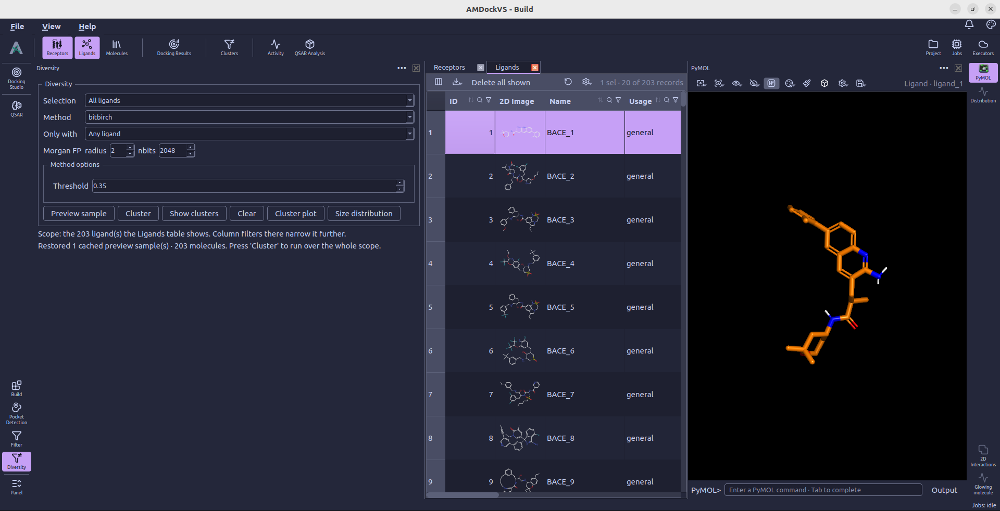
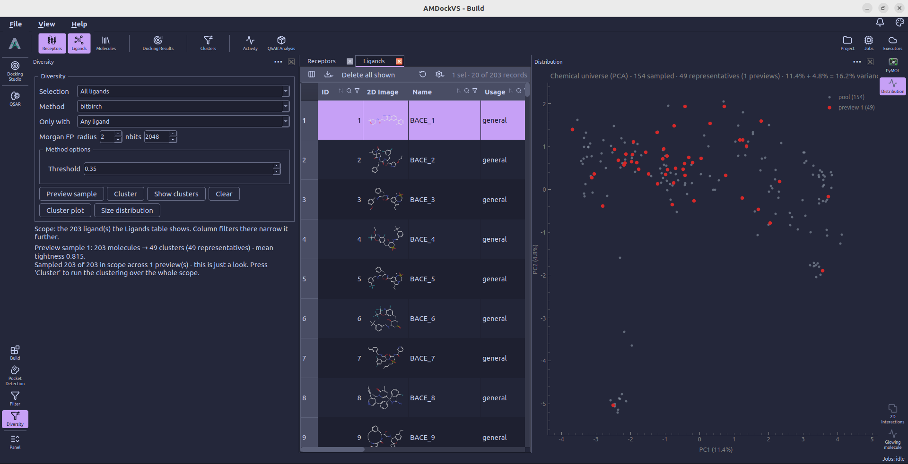
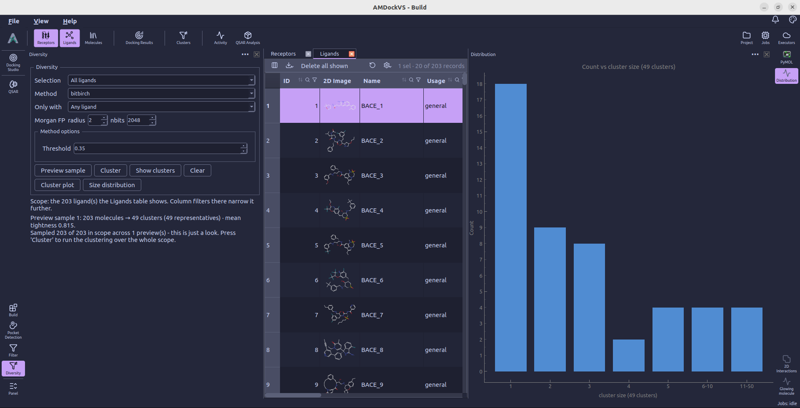
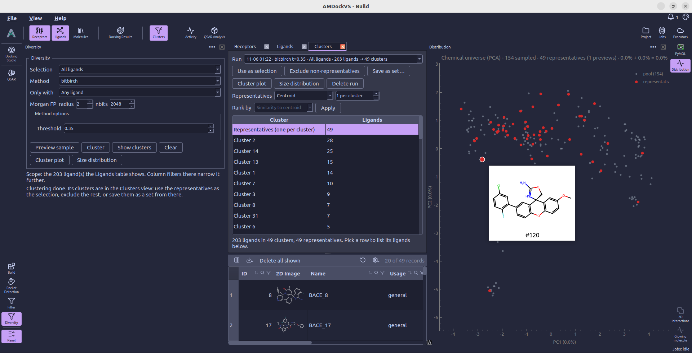

#  Diversity

**Diversity** groups ligands by molecular similarity and lets you choose
representatives from the resulting clusters. Open it from the left tool rail
to configure a run. Completed runs are reviewed in the separate **Clusters**
view, opened from the top catalog or through **Show clusters**.

Clustering records a result without automatically changing the global ligand
selection or excluding compounds. Those actions are available after you
review the clusters.

## 1. Choose the ligands

Use **Selection** to choose **All ligands**, **Current selection**, a usage
class (**General**, **Reference**, or **General + Reference**), or a saved set.
When the project has a sharded screening library, **Screening library (shards)**
is also available.

**Current selection** uses the global ligand selection made with
**right-click → Select** in a ligand table. Other choices use their own scope
and ignore that selection. For project rows, the Ligands table shows the
chosen scope while the tool is open, and its column filters can narrow it
further.

**Only with** can restrict project ligands to those with a value for an
activity endpoint. Leave it at **Any ligand** when activity measurements
are not required for your clustering run.

## 2. Configure similarity and clustering

Choose a **Method** (currently **BitBIRCH**) and set its **Threshold** in **Method options**. Higher
thresholds produce tighter clusters and generally retain more clusters.
Some methods also expose a batch-size control.

Under **Morgan FP**, set the fingerprint **radius** and **nbits**. The initial
values are radius 2 and 2048 bits. The fingerprint settings affect similarity,
so evaluate the clustering threshold together with those settings.

## 3. Preview a sample

**Preview sample** clusters a random sample to help you adjust the method and
threshold before submitting a full run. It displays a two-dimensional
projection in the Distribution panel. Repeated previews accumulate samples;
once all molecules in the scope have been previewed, another click restores
the existing plot. Changing the method, threshold, or other method options
starts a fresh preview with the new settings. **Clear** resets the accumulated
preview when you want to start again with the same settings.

**Size distribution** replaces the scatter plot with a histogram of
compounds per cluster. Use it to see whether the preview contains many
singletons or a few large clusters. Select **Cluster plot** to return to the
accumulated scatter plot without taking another sample or clustering again.
Previewing does not change molecule
selection or exclusion state, and it does not replace a full clustering run.

## 4. Cluster the full scope

Select **Cluster**. AMDockVS counts the molecules and suggests a CPU count;
accept or adjust that count to submit the clustering job. Follow the job in
the [Jobs monitor](jobs_monitor.md). The completed run opens in **Clusters**, where its scope,
clusters, and representative molecules can be reviewed.

For a sharded screening library, clustering works on the library in its
shards; its representatives become project ligand rows.

## 5. Choose representatives

In **Clusters**, select a run and review the representative row or an
individual cluster to see its ligands. The **Representatives** controls let
you change the selection strategy:

- **Centroid** chooses members closest to the cluster centroid.
- **Medoid** chooses members most similar, on average, to the rest of the
  cluster.
- **Extremes** chooses members spanning the low, middle, and high values of
  the selected ranking.
- **Quartiles** samples across quartiles of that ranking.
- **Proportional** allocates representatives according to cluster size.

For strategies that use **Rank by**, choose similarity to the centroid or an
available activity endpoint. Select **Apply** to update the representatives
for that run.

## 6. Use the result

- **Use as selection** makes the ligands currently listed in the result view
  the global ligand selection, ready for tools such as Docking Studio.
- **Save as set...** stores the run's representatives as a named ligand set.
- **Exclude non-representatives** marks the other ligands of the run as
  excluded while retaining their records in the project.
- **Size distribution** plots the cluster-size distribution for the run.
- **Cluster plot** returns to the run's scatter plot, keeping the selected
  cluster and using the existing results without rerunning clustering.
- **Delete run** removes the saved clustering run; it is separate from
  excluding molecules.

If the result is too large for a table selection, save the representatives
as a set or use the exclusion action instead.

Continue with [Docking Studio](docking_studio.md) to dock a selected subset,
or [QSAR](qsar.md) to model ligands with activity measurements.
