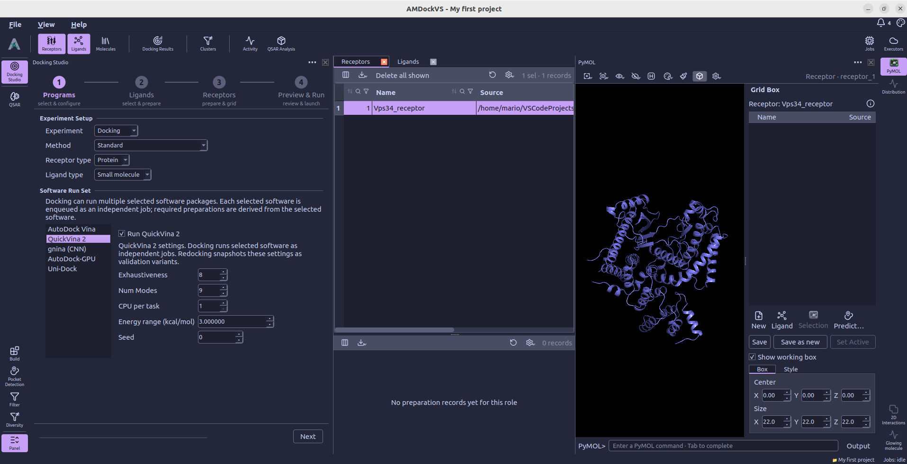
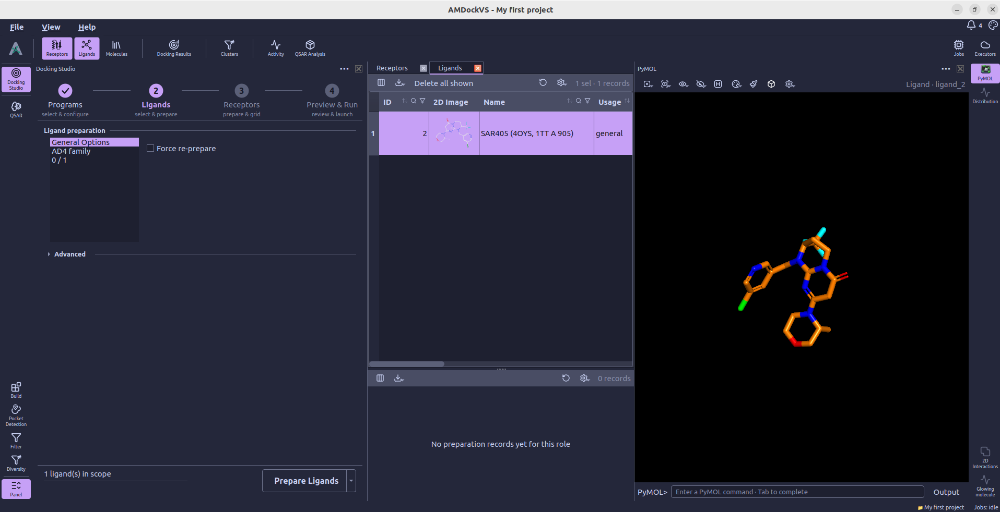
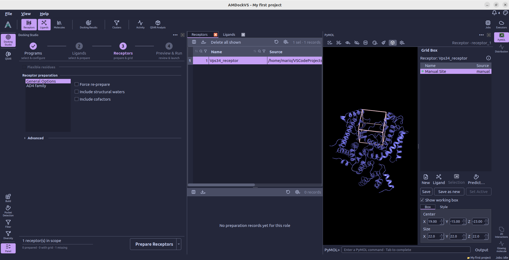
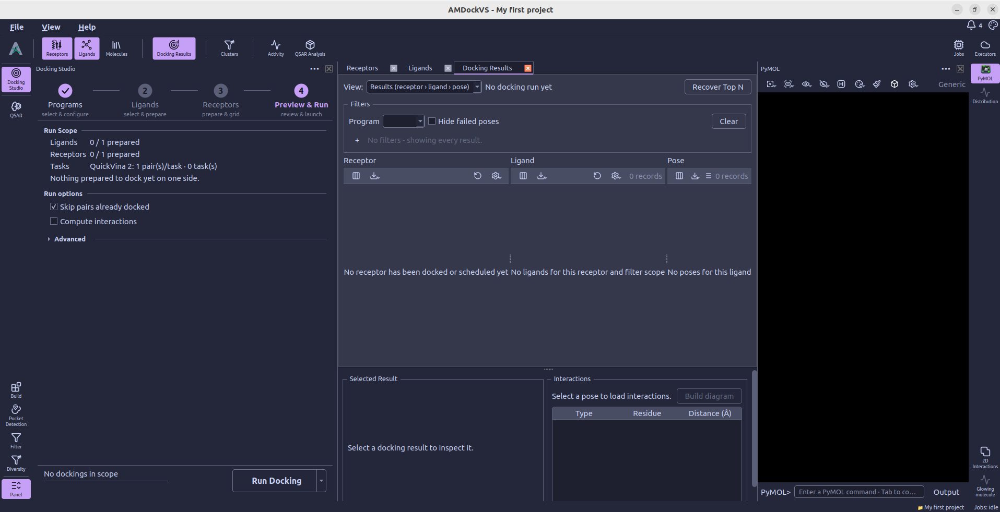
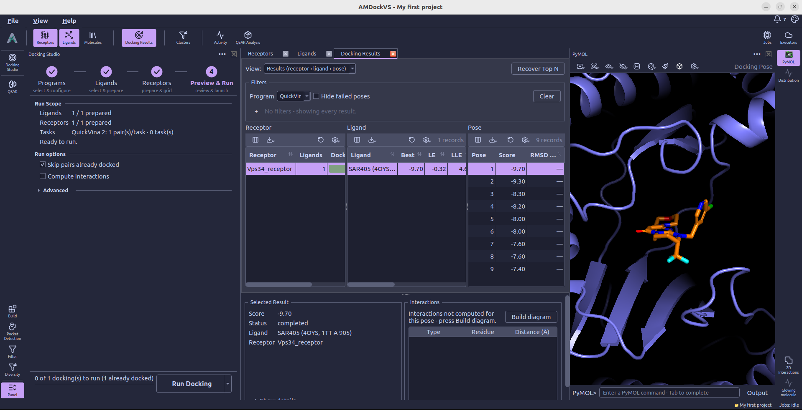

#  Docking Studio

Docking Studio guides a docking run through four revisitable steps. In the first step **Programs**, users select the docking programs and settings. In second and third steps (**Ligands** and **Receptors**), users prepare the ligands and receptors for docking. The fourth step **Preview & Run** checks preparation and docking readiness before submitting work.

## Typical workflow

  <ol class="tool-workflow__steps">
    <li>
      01
      <strong>Programs</strong>
      Select docking engines and settings
    </li>
    <li>
      02
      <strong>Ligands</strong>
      Prepare compound(s)
    </li>
    <li>
      03
      <strong>Receptors</strong>
      Prepare receptor(s) and define search space(s)
    </li>
    <li>
      04
      <strong>Preview &amp; Run</strong>
      Check and launch
    </li>
  </ol>
  
↳<strong>Docking Results</strong>Scores · poses · interactions

You can return to any setup step to adjust its settings.

## 1. Choose programs {#programs}

In this section, the users set the docking mode, select the docking programs to use, and configure program-specific settings. The docking mode can be either **Docking** or **Redocking**. In **Docking** mode, the selected programs will perform docking runs on the provided ligands and receptors. In **Redocking** mode, users can validate the docking protocols by attempting to reproduce known binding poses of ligands in their respective receptors. This is useful for validation purposes, as it allows users to assess the accuracy and reliability of the docking programs and settings they have chosen.

Available programs include AutoDock Vina, QuickVina 2, gnina, AutoDock-GPU and Uni-Dock. Program-specific settings appear when you select a program. The user can choose to run more than one program in parallel, and the docking results will be organized by program in the results view.

## 2. Prepare ligands {#ligands}

This step uses the ligand scope shown in the Ligands catalog; it does not have
a separate table or scope selector. Select a preparation target to see its
options. **General Options** includes **Force re-prepare**; the other entries
correspond to preparation families shared by the selected docking programs.

If the project contains a sharded screening library, choose whether to prepare
ligand rows, shards, or both under **Ligands from**. Advanced settings include
preparation batch size and, when available, the execution destination. Select
**Prepare Ligands** to submit preparation jobs and follow their progress in the
[Jobs monitor](jobs_monitor.md).

## 3. Prepare receptors {#receptors}

The Receptors catalog supplies the scope for this step. Select a receptor there
to inspect or change its active search box and grid settings. The **Receptor preparation** section has general options and options for the preparation families used by the selected programs. **Force re-prepare**, batch size and the execution destination are available here. Select **Prepare
Receptors** to submit the preparation jobs.

## 4. Preview and Run {#preview-run}

Review prepared ligand and receptor counts and the estimated docking tasks. A
receptor must be prepared and have a search box before it is ready, otherwise it is skipped during docking. If
preparation remains, **Run Docking** waits for the required preparation jobs to
finish before submitting docking.

**Skip pairs already docked** is on by default; turn it off to run those
receptor-ligand pairs again and replace their previous results. **Compute
interactions** analyzes each pose after docking and stores the interaction data
with the results. Advanced settings include docking batch size and, when
available, the execution destination.

For a sharded screening library, **Screening hits** sets the score threshold
and the maximum number of hits retained per receptor. Optional off-target
docking first screens against a reference receptor, then docks the selected
hits against the other ready receptors.

## 5. Review results {#results}

After submission, Docking Studio opens **Docking Results** automatically. The main results
table organizes poses by receptor, ligand and pose; additional tables provide
off-target comparisons and redocking results when those data are available.
Select a pose to inspect its score and structure, and view interaction diagrams
when interaction analysis was computed.

