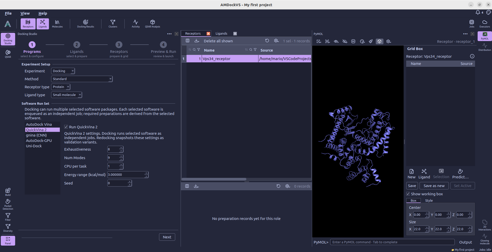
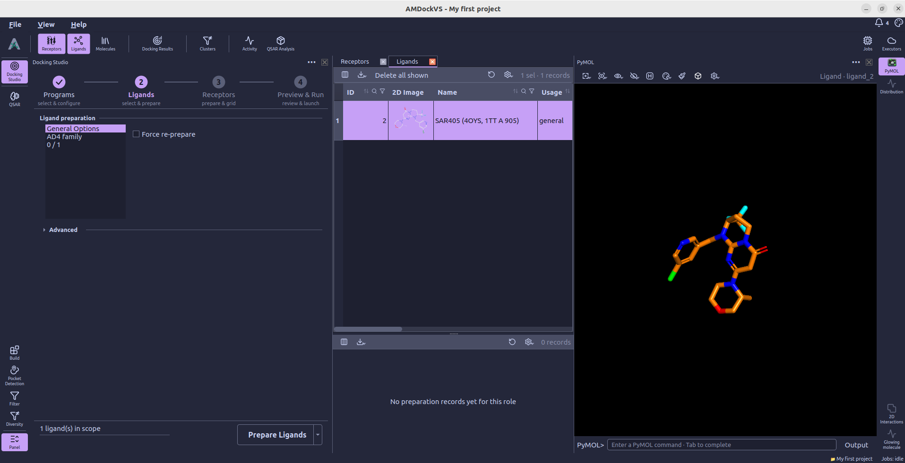
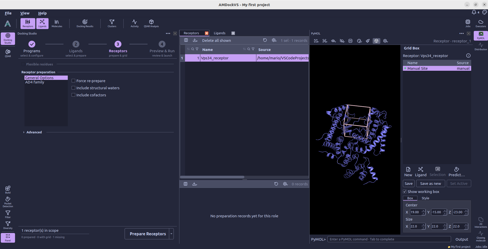
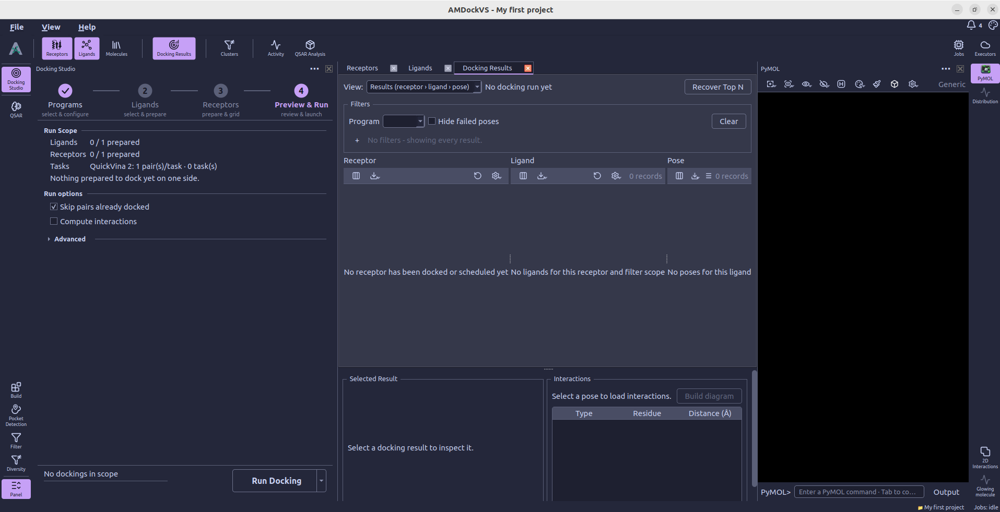
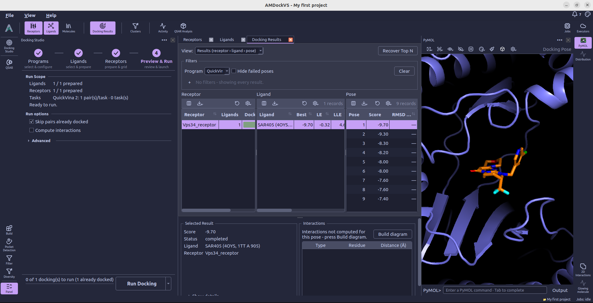

#  Docking Studio

Docking Studio guides a docking run through four revisitable steps. In the first step **Programs**, users select the docking programs and settings. In second and third steps (**Ligands** and **Receptors**), users prepare the ligands and receptors for docking. The fourth step **Preview & Run** checks preparation and docking readiness before submitting work.

## Typical workflow

  <ol class="tool-workflow__steps">
    <li>
      01
      <strong>Programs</strong>
      Select docking engines and settings
    </li>
    <li>
      02
      <strong>Ligands</strong>
      Prepare compound(s)
    </li>
    <li>
      03
      <strong>Receptors</strong>
      Prepare receptor(s) and define search space(s)
    </li>
    <li>
      04
      <strong>Preview &amp; Run</strong>
      Check and launch
    </li>
  </ol>
  
↳<strong>Docking Results</strong>Scores · poses · interactions

You can return to any setup step to adjust its settings.

## 1. Choose programs {#programs}

In this section, the users set the docking mode, select the docking programs to use, and configure program-specific settings. The docking mode can be either **Docking** or **Redocking**. In **Docking** mode, the selected programs will perform docking runs on the provided ligands and receptors. In **Redocking** mode, users can validate the docking protocols by attempting to reproduce known binding poses of ligands in their respective receptors. This is useful for validation purposes, as it allows users to assess the accuracy and reliability of the docking programs and settings they have chosen.

Available programs include AutoDock Vina, QuickVina 2, gnina, AutoDock-GPU and Uni-Dock. Program-specific settings appear when you select a program. The user can choose to run more than one program in parallel, and the docking results will be organized by program in the results view.

### Reproducing a Uni-Dock run {#unidock-seed}

Uni-Dock docks a task's ligands in GPU batches it fills from the memory free on the card when the process starts, and a ligand's search trajectory depends on its place in its batch. Entering a nonzero **Random seed** therefore switches Uni-Dock to a fixed recipe: the ligands are read on one thread, tasks keep the size they are given, and each task is sized to dock in a single GPU batch. **Preview & Run** shows the resolved pairs per task. Settings > Docking > Uni-Dock holds the two numbers behind it: **Pairs per seeded task** (0 derives it) and **Seeded GPU memory floor**, the free memory a seeded run may count on — raise it for a card nothing else is using, and the tasks grow with it.

Repeat a seeded run with the same inputs, the same ordered scope and the same pairs per task to get the same poses; a partial rerun groups the remaining ligands differently, so clear **Skip pairs already docked** to recompute a whole screen. If a card ends up with less memory free than the floor, Uni-Dock splits a task anyway: those pairs fail with the batch sizes it used instead of returning scores that would not come back.

## 2. Prepare ligands {#ligands}

This step uses the ligand scope shown in the Ligands catalog; it does not have
a separate table or scope selector. Select a preparation target to see its
options. **General Options** includes **Force re-prepare**; the other entries
correspond to preparation families shared by the selected docking programs.

If the project contains a sharded screening library, choose whether to prepare
ligand rows, shards, or both under **Ligands from**. Advanced settings include
preparation batch size and, when available, the execution destination. Select
**Prepare Ligands** to submit preparation jobs and follow their progress in the
[Jobs monitor](jobs_monitor.md).

## 3. Prepare receptors {#receptors}

The Receptors catalog supplies the scope for this step. Select a receptor there
to inspect or change its active search box and grid settings. The **Receptor preparation** section has general options and options for the preparation families used by the selected programs. **Force re-prepare**, batch size and the execution destination are available here. Select **Prepare
Receptors** to submit the preparation jobs.

- **Include cofactors** keeps the cofactors kept at import (FAD, NAD, HEM, SAM, ...) in the
  receptor PDBQT, typed and charged at pH 7 from their chemical component. Off by default:
  the cofactor pocket is then empty, and a ligand can dock into it.
- **Charge metal ions** gives bare Mg, Mn, Ca, Fe and Cu ions their formal charge instead of
  0. Zinc stays at 0, as AutoDock4Zn expects. Off by default; only AutoDock4 and AutoDock-GPU
  read the charges.
- The **Warnings** column of the Receptors preparation table says what a ready receptor's
  PDBQT cannot: a residue that could not be typed, or a cofactor whose charge is fractional
  because the structure lacks some of its atoms.

The prepared file does not record these options: after changing one, use **Force
re-prepare** on receptors that are already prepared.

## 4. Preview and Run {#preview-run}

Review prepared ligand and receptor counts and the estimated docking tasks. A
receptor must be prepared and have a search box before it is ready, otherwise it is skipped during docking. If
preparation remains, **Run Docking** waits for the required preparation jobs to
finish before submitting docking.

**Skip pairs already docked** is on by default; turn it off to run those
receptor-ligand pairs again and replace their previous results. **Compute
interactions** analyzes each pose after docking and stores the interaction data
with the results. Advanced settings include docking batch size and, when
available, the execution destination.

### One configuration per program {#one-configuration}

A project keeps a single docking configuration per program, so the results of a program are
all comparable with each other. Redocking is the exception: it may hold several protocols,
since comparing them is the point.

Changing a program's search settings once it already has docking results stops the run
rather than mixing two kinds of result together, and offers to replace that program's
results or to cancel. What counts as a change is the search itself — scoring function,
exhaustiveness, seed, energy range, minimum RMSD, grid spacing, and a non-standard method.
The number of poses kept (`num_modes`) does not: it says how many poses of the same search
are stored, so asking for more poses later is a redock of the same protocol.

Replacing deletes that program's docking results in the project — poses, the analyses
derived from them, the counters, and the per-shard result files — and does it after the
request is checked but before the new run is submitted. A new run that then fails or is
cancelled does not bring the deleted results back. Redocking results, other programs'
results and the prepared ligand library are left alone. Through the API the same situation
raises `DockingProtocolConflictError`, and `replace_existing=True` is the confirmation.

For a sharded screening library, **Screening hits** sets the score threshold
and the maximum number of hits retained per receptor. Optional off-target
docking first screens against a reference receptor, then docks the selected
hits against the other ready receptors.

## 5. Review results {#results}

After submission, Docking Studio opens **Docking Results** automatically. The main results
table organizes poses by receptor, ligand and pose; additional tables provide
off-target comparisons and redocking results when those data are available.
Select a pose to inspect its score and structure, and view interaction diagrams
when interaction analysis was computed.

