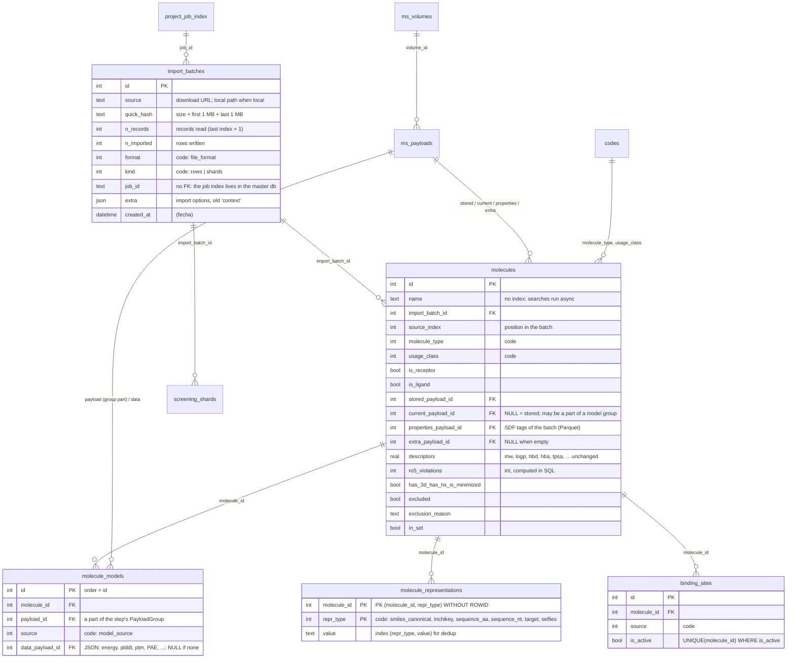
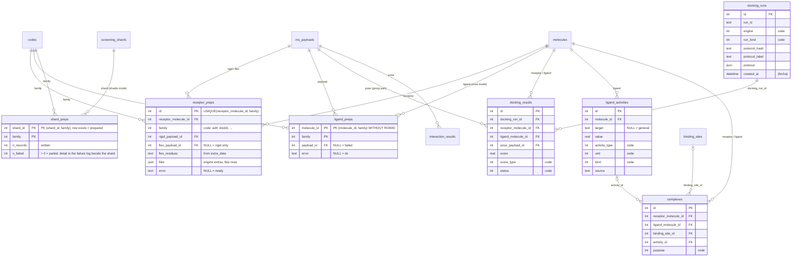
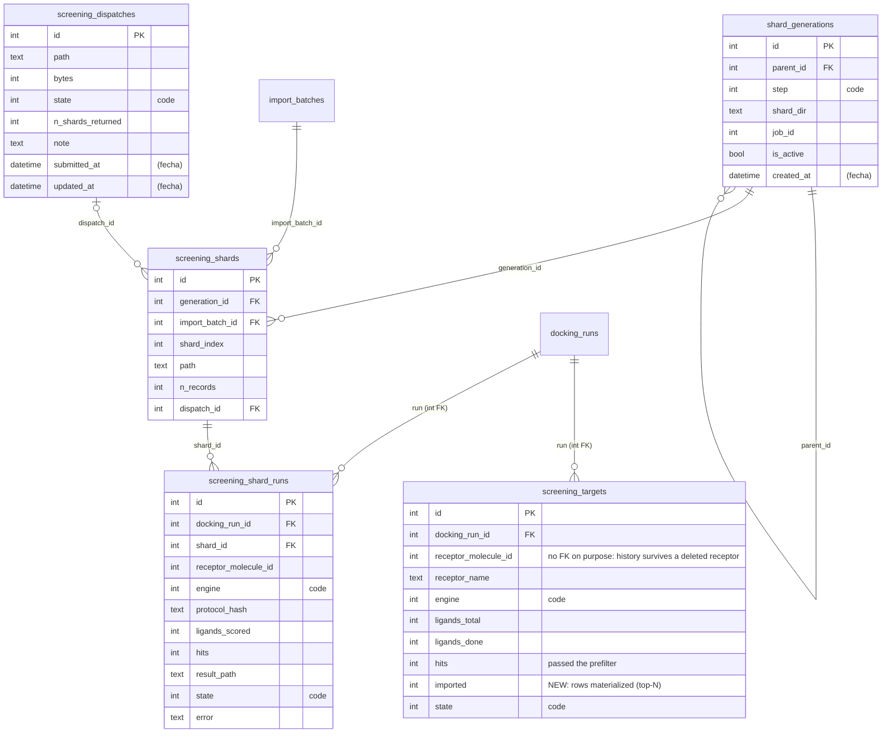

# Esquema propuesto (fase 1) — 2026-10-24

Propuesta acordada con Mario; nada implementado. Proyectos nuevos solamente: no hay migración.

Leyenda en los atributos:
- `code` = FK entera a `codes` (ver §5);
- **(fecha)** = la tabla conserva sus fechas: es corrida, job o `projects`;
- la lista "Se va" de cada sección es lo que desaparece respecto al esquema actual.

## 1. Importación y moléculas



**Se va de `molecules`:**
- `created_at`, `updated_at`, `source`, `input_format`, `primary_context`: los cubre el lote;
- `current_model_index`: el modelo activo es el que tiene `payload_id = current_payload_id`;
- `has_activity`: pasa a ser un `EXISTS` sobre `ligand_activities`;
- `active_binding_site_id`: pasa a `binding_sites.is_active`;
- `canonical_smiles` e `inchikey`: pasan a representaciones;
- `extra_data`: se reparte así:
  - `smiles` y `sequence_1d`: eran duplicados y se eliminan;
  - `flexible_residues`: pasa a `receptor_preps`;
  - el resto: pasa a `extra_payload_id`.

**Se van como tablas:** `molecule_source_properties` (muerta desde el payload Parquet de propiedades).

**Modelos:** cada paso que genera varios modelos de una molécula (conformeros, modelos ESMFold/AF, NMR) los escribe como un solo `PayloadGroup`, para que compriman juntos, como las poses. El modelo actual no se duplica: leerlo descomprime su grupo, que cuesta < 1 ms con 20 conformeros y ~2 ms con 5 modelos de proteína. Un paso con un solo modelo escribe un payload normal.

**Diana:** `repr_type = 'target'` (UniProt, ChEMBL o un nombre), solo cuando aplica. Un polímero o un nanotubo no lleva fila. El cross-docking agrupa receptores por ese valor.

**¿Ya se importó?**
1. Al empezar se calcula `quick_hash`, unos 2 ms para cualquier tamaño, y se busca un lote con ese mismo hash.
2. Si existe y `n_records` coincide → importación completa: se avisa y no se escribe nada salvo que el usuario lo fuerce.
3. Si existe con `n_records` menor → importación parcial: se avisa. Reanudar queda para después.

**Implementado (paso 6):**

- El lote se registra al enviar el job (`LoaderAPI` → `io/batches.py::register_batches`), no dentro de él: el job lleva `import_batch_ids` (ruta resuelta → id) en sus params, así que un job reanudado escribe en los mismos lotes. `stamp_job` pone `job_id` tras el envío.
- `job_id` es texto sin FK: `project_job_index` vive en la base maestra, no en `project.db`.
- Duplicado: solo si el hash coincide se cuentan los registros del archivo (`count_import_records`). Completo → `DuplicateImportError`, salvo `force=True`; la UI pregunta antes de enviar (`confirm_reimport`). Parcial → entra sin preguntar.
- El `finalize` del job (`finish_import`) cuenta lo escrito: `n_imported` = filas en `molecules`, o la suma de `n_records` de los shards; `n_records` = el conteo exacto si el job terminó, o el último `source_index + 1` si no.
- `context`, `role` y las opciones van en `extra`. El formato del shard sale del tipo de payload del `.mshard`.
- Los hits de shards se llaman `<stem del lote>:<record id>` (`library_names`), y la reutilización de hits ya promovidos usa `(import_batch_id, source_index)`.
- Catálogo: Source/Format son subconsultas sobre el lote (`batch_columns`), ordenables pero no filtrables: un filtro sobre una expresión no tiene forma `QuerySpec`. Se filtra por la columna oculta `import_batch_id`.
- Filas y shards conviven (Mario, 2026-10-25): se quitó `check_library_target`, y una importación de filas en un proyecto con shards ya no se marca `reference` sola.
- Sin migración: un proyecto anterior se vuelve a importar.

**Implementado (pasos 7-8):**

- Modelo activo: el que tiene `payload_id = molecule_payload_id(molecule)`, es decir `current_payload_id` o, si es NULL, `stored_payload_id` (paso 2).
- `has_activity` es una subconsulta `EXISTS` sobre `ligand_activities`, ordenable en el catálogo.
- `binding_sites.is_active` con índice único parcial `uq_binding_site_active`; activar un sitio apaga los demás de la molécula en la misma transacción.
- Identidad (`inchikey`, `smiles_canonical`) en `molecule_representations`, PK `(molecule_id, repr_type)` WITHOUT ROWID; el import, el job de alertas, la edición y `select_fragment` escriben esas filas (upsert).
- `extra_data` pierde `smiles` y `sequence_1d`. El SMILES de un hit promovido desde un shard va como `smiles_isomeric`.
- **Aplazado:** `extra_data` → `extra_payload_id`. Toca ~24 archivos, y una fila de librería ya guarda `{}`, así que el ahorro es pequeño. Se hace cuando moleste.
- `molecule_models` pierde `model_index`, `energy`, `metrics` y `pae_payload_id`: el orden es el `id`. `energy` nunca se escribía. ESMFold guarda métricas + PAE (lista) en `data_payload_id` como JSON, que el panel de detalles muestra sin el PAE.
- Un ensamble de conformeros es un `PayloadGroup` (`sdf`, una parte por conformero); el modelo actual es la primera parte. Un paso con un solo modelo (protonar, ESMFold) escribe un payload normal.

## 2. Preparación y docking



**Preparación:**
- Se registra por familia (`ProgramSpec.preparation_engine`): Vina, QuickVina, gnina y AutoDock-GPU comparten `ad4`.
- **Bypass:** las familias con `requires_*_preparation = False` (DiffDock, Boltz, ESMFold…) no crean filas; el docking lee el SMILES o la secuencia del payload almacenado.
- **Rejillas:** no tienen tabla. "Rejilla lista" significa que el receptor tiene un sitio activo, y los mapas AD4 se generan por tarea.

**Se va:**
- `engines`: sustituida por `receptor_preps` y `ligand_preps`;
- `shard_engine_states`: sustituida por `shard_preps`. Su ruta se deriva (`<carpeta del shard>/prepared_<familia>/<mismo nombre>`); `is_ready`, `files` y `error` desaparecen;
- `consensus_scores`;
- las fechas de `engines`, `complexes`, `ligand_activities` e `interaction_results`.

**Actividades:** una misma fila sirve a la vez para QSAR general, para QSAR/LBVS por diana (filtrando `target`) y para los complejos (redocking o evaluación de programas). Distinguir un uso de otro corresponde a los filtros de cada herramienta; se analiza más adelante.

**Implementado (paso 9):**

- Una fila de preparación por (molécula, familia). `family` es un `code` (`prep_family`); el motor de docking se resuelve a su familia con `get_docking_program(engine).preparation_engine`.
- `receptor_preps`: `rigid_payload_id`, `flex_payload_id`, `flex_residues` (la selección de cadenas laterales flexibles, que una re-preparación conserva) y `error`. El JSON `files` desaparece. `clear_derived` borra también la selección flexible.
- `ligand_preps` es WITHOUT ROWID, PK `(molecule_id, family)`: lista = `payload_id` no NULL; si falla, NULL con `error`.
- `shard_preps`: una fila por shard preparado, con la ruta derivada.
- Sin migración: un proyecto anterior se vuelve a preparar.

## 3. Cribado (shards)



**Se va de `screening_shards`:** `source` e `input_format` (pasan al lote), `state` (`set_shard_state` no tiene llamadas: nunca cambia) y las fechas.
**Se va de `screening_targets` y `screening_shard_runs`:** las fechas (la corrida ya tiene la suya) y el `run_id` de texto, que pasa a FK entera.

**Hits:**
- Solo existe el top-N ranked: los N mejores **por receptor**, elegidos al final de la corrida desde los fragmentos. Si la corrida se cancela, `recover_ranked_hits` recupera un top-N parcial.
- El modo umbral (los primeros N que pasan) se elimina. El umbral queda solo como prefiltro opcional.
- Tope de la UI: **10.000** (antes 1.000.000).

**Tareas de docking:**
- Una tarea toma uno o más shards **completos** y escribe un fragmento por cada (shard de entrada, receptor). Nunca se parte un shard.
- El número de shards por tarea es solo un ajuste de reparto de trabajo.
- El número de archivos se controla con el tamaño de shard al importar y con la compactación de la fase 3.

**Cancelación a mitad:**
- Ni el shard preparado ni el fragmento de resultados quedan como hechos. Los archivos se escriben como `.tmp` y se renombran al cerrar.
- La fila o el recibo se escriben después del archivo.
- Ventana restante: si el archivo se cerró pero la fila seguía en el buffer del sink, el shard se rehace y sobrescribe el archivo con el mismo contenido.

**Implementado (pasos 10-11):**

- `screening_targets` y `screening_shard_runs` llevan `docking_run_id` (FK a `docking_runs.id`): un envío con dos protocolos ya no comparte filas de diana. `find_docking_run(...)` (`docking/results/repository.py`) encuentra la corrida; `docking_run_id(...)` la crea.
- `screening_targets.imported` cuenta los hits materializados como filas.
- `screening_shards.state` y `ShardState` fuera.
- Solo top-N: el umbral es un prefiltro (por defecto 0,0) y el tope de la UI es 10.000. El modo umbral/streaming y su techo se eliminaron. `ShardHitWriter` solo materializa hits sobre la marcha en el embudo off-target (`selected_from_receptor_id`).
- `shards.hit_cap` y `DEFAULT_HIT_SAFETY_CAP` quedan en la config sin uso: la config es `extra="forbid"` y quitarlos rompería las configs guardadas.
- Paso 11: `consensus_scores` y `molecule_source_properties` fuera. Las propiedades de origen siempre van al payload Parquet (se quitó la variable `AMDOCK_OFFLOAD_IMPORT_PROPERTIES`).

## 4. Análisis y ms_flow

Las relaciones no cambian. Las fechas solo se quedan en las corridas:

| Tabla | Fechas | Categóricas → `code` |
|---|---|---|
| `clustering_runs` | se quedan | `method` |
| `qsar_models` | se quedan | `algorithm`, `feature_type` |
| `clustering_results`, `similarity_results`, `fingerprint_records`, `descriptor_blocks`, `descriptor_schemas`, `qsar_predictions`, `molecule_sets`, `molecule_set_members` | se van | `molecule_sets.purpose` |
| ms_flow `projects`, `project_job_index`, `project_operation_runs` | se quedan | — |
| ms_flow `project_artifacts`, `project_artifact_capabilities`, `ms_volumes`, `ms_payload_dicts` | se van | — |

## 5. `codes`

```
codes(id INTEGER PRIMARY KEY, domain TEXT, name TEXT, UNIQUE(domain, name))
```

- Se siembra desde `core/vocab.py` al crear el proyecto y se carga a un dict al abrirlo, así que las consultas de la app no pagan ningún join.
- Python resuelve siempre por `(domain, name)` y nunca escribe enteros a mano. Cada proyecto lleva su propio mapa.
- Un valor nuevo es un `INSERT` al abrir el proyecto, sin migración.
- Hace que el `.db` sea legible desde fuera (web, pandas, DuckDB).
- La FK no impide guardar un código de otro dominio en la columna equivocada. Eso lo evita que la app solo resuelva códigos dentro del dominio de cada columna.

**Implementado (paso 5):**

- El mapa es estático: `vocab.CODES` es el mismo en todos los proyectos y solo se le añade al final de cada dominio; un id nunca se renumera ni se reutiliza. No hace falta cargar nada al abrir el proyecto. `codes` se siembra con `after_create` y `ensure_codes` añade al abrir lo que falte.
- `models/codes.py::CodeType` (TypeDecorator) convierte nombre ↔ id: '' se guarda NULL, un nombre desconocido lanza `ValueError`. ms_flow aplica el tipo en filtros y lecturas declarativas (`QuerySpec`, subconsultas incluidas). En SQL crudo se usan `code_id(domain, name)` y `code_name_sql(column)`.
- Se quedan en texto: `activity_type` y `unit`, que son endpoints que define el usuario, y `shard_generations.step`, que es una etiqueta compuesta (`protonate+3d`).
- Pasan a otro paso: `file_format` e `import_kind` (paso 6, `import_batches`), `prep_family` (paso 9) y `result_status` (no existe columna: se deriva de `score IS NULL`).
- `clustering_method` incluye `bitbirch`, el único método registrado hoy.

| Dominio | Columnas |
|---|---|
| `molecule_type` | `molecules.molecule_type` |
| `usage_class` | `molecules.usage_class` |
| `file_format` | `import_batches.format` |
| `import_kind` | `import_batches.kind` |
| `model_source` | `molecule_models.source` |
| `repr_type` | `molecule_representations.repr_type` |
| `binding_site_source` | `binding_sites.source` |
| `prep_family` | `receptor_preps.family`, `ligand_preps.family`, `shard_preps.family` |
| `engine` | `docking_runs.engine`, `screening_targets.engine`, `screening_shard_runs.engine` |
| `run_kind` | `docking_runs.run_kind` |
| `score_type`, `result_status` | `docking_results` |
| `activity_type`, `activity_unit`, `activity_kind` | `ligand_activities` |
| `complex_purpose` | `complexes.purpose` |
| `run_state`, `dispatch_state` | `screening_targets` / `screening_shard_runs`, `screening_dispatches` |
| `generation_step` | `shard_generations.step` |
| `clustering_method`, `qsar_algorithm`, `feature_type`, `set_purpose` | análisis |

## Orden de implementación (fase 1, un commit por punto en db/sqlite)

1. Índices: quitar `ix_molecules_name`; índices parciales para current/properties. `ix_molecules_usage_class` se queda: sin él una página por rol ordena la tabla entera (medido: 0,1 ms → 65 ms en 1M filas).
2. `current_payload_id` NULL = stored.
3. Ro5 en SQL.
4. Fechas fuera (diálogos de fallos devuelven ids; `engines` ordenado por id; columnas de fecha de la UI fuera).
5. `codes` + columnas categóricas a entero.
6. `import_batches` (+ `quick_hash`, aviso de duplicado) y las columnas de origen fuera de `molecules` / `screening_shards`.
7. `molecules` adelgaza: `current_model_index`, `has_activity`, `active_binding_site_id` → `binding_sites.is_active`, identidad → representaciones, `extra_data` → `extra_payload_id`.
8. Modelos: `PayloadGroup` por paso + `data_payload_id`.
9. Preparación: `receptor_preps` / `ligand_preps` / `shard_preps`; fuera `engines` y `shard_engine_states`.
10. Cribado: `run_id` → FK entera, `imported`, fuera `screening_shards.state`; solo top-N con tope 10k.
11. Bajas: `consensus_scores`, `molecule_source_properties`.
