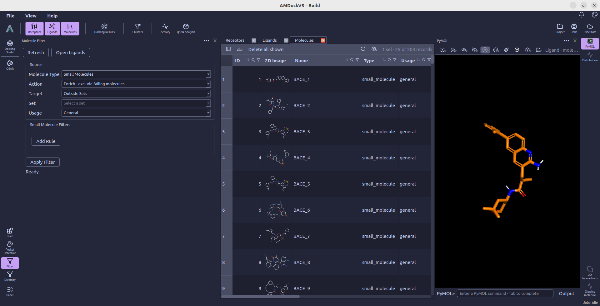
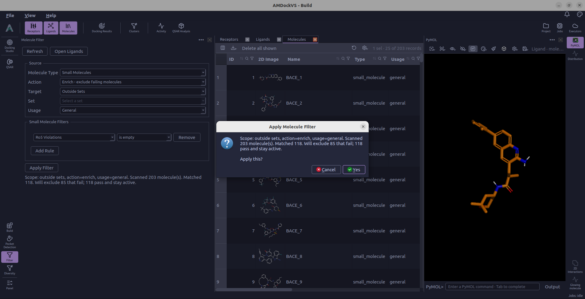

#  Filter

**Filter** applies property rules to small-molecule records in the project.
Use it to exclude molecules that fail your criteria, recover molecules
previously excluded by this filter, or save matching molecules as a set.
Open the tool from the left rail; the central Molecules table follows the
source configured in the panel.

## 1. Choose the source

Under **Source**, select **Small Molecules** as the **Molecule Type**.
The other listed types—proteins, peptides, nucleotides, and polymers—do not
yet have filter criteria in this panel.

Choose a **Target**:

- **Outside Sets** — Molecules that do not belong to a set.
- **Inside Sets** — Molecules belonging to sets.
- **All Molecules** — Include molecules regardless of set membership.
- **Specific Set** — Choose one saved set from the **Set** list.

**Usage** further restricts the source to **General**, **Reference**,
**Derived**, **General + Reference**, or **All**. The panel's Target and Usage
controls define the filter source; review them before applying an action.

## 2. Choose an action

- **Enrich - exclude failing molecules** evaluates active molecules and marks
  those that fail as excluded. The records remain in the project.
- **Recover - re-include filter-excluded that now pass** evaluates excluded
  molecules and restores those that pass the new criteria. It only recovers
  exclusions made by this Filter tool; exclusions made manually or by other
  tools remain in place.
- **Tag matches to a set (no state change)** saves matching active molecules
  into the named set without changing their exclusion state. Enter the name
  under **Tag into set**.

## 3. Add criteria

Select **Add Rule**, choose a property and comparison operator, and enter its
value when required. Add more rows to combine criteria; a molecule must pass
every rule. Use **Remove** beside a row to discard it.

Available numeric properties include molecular weight, logP, hydrogen-bond
donors and acceptors, TPSA, rotatable bonds, fragment count, total and aromatic
ring counts, heteroatom and heavy-atom counts, formal charge, fraction Csp3,
and total atom count. Numeric rules support `<`, `<=`, `>`, `>=`, and `=`.

**PAINS Matches** and **Ro5 Violations** use **is empty** or **has any**.
For example, **PAINS Matches → is empty** keeps molecules with no detected
PAINS matches. **Ro5 Violations → is empty** requires no recorded Rule of 5
violations.

For a molecular-weight interval, add two rules, such as **MW (Da) >= 200**
and **MW (Da) <= 500**. These are example bounds; choose limits appropriate
to your compound collection.

## 4. Review counts and apply

Select **Apply Filter**, or **Tag to Set** for the tagging action. AMDockVS
evaluates the source and reports the counts before asking whether to apply
the changes. Canceling that confirmation leaves the counts visible without
changing the molecules.

Molecules missing properties required by the rules are reported as skipped.
If a PAINS rule requires results that have not been calculated, the tool can
offer to calculate PAINS matches before you try the filter again.

After applying, review the summary and open the Ligands catalog to inspect
the resulting scope or saved set. You can use a saved set as input to
[Diversity](diversity.md) or select its members for
[Docking Studio](docking_studio.md).
