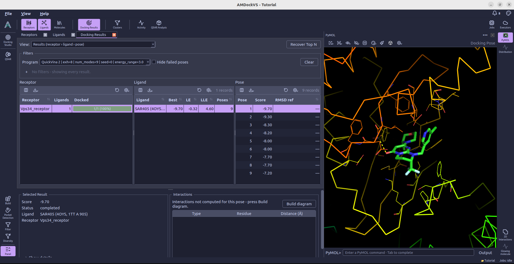

# AMDockVS

AMDockVS is the next-generation version of [Assisted Molecular Docking (AMDock)](https://doi.org/10.1186/s13062-020-00267-2), published in 2020. The new version is a desktop application and Python API that includes molecular import, preparation, QSAR, binding-site analysis, docking, and result inspection.

!!! citation "Cite AMDock"

    <a href="https://www.scimagojr.com/journalsearch.php?q=5800173376&amp;tip=sid&amp;exact=no" title="SCImago Journal &amp; Country Rank"></a>

    The original AMDock paper was published in *Biology Direct* and is available [here](https://doi.org/10.1186/s13062-020-00267-2). If you use AMDock, please cite it as follows:

    Valdés-Tresanco, M.S., Valdés-Tresanco, M.E., Valiente, P.A. et al. *AMDock: a versatile graphical tool for assisting molecular docking with Autodock Vina and Autodock4*. **Biology Direct** 15, 12 (2020). https://doi.org/10.1186/s13062-020-00267-2

    <span class="__dimensions_badge_embed__" data-doi="10.1186/s13062-020-00267-2" data-style="medium_circle" data-legend="always"></span><script async src="https://badge.dimensions.ai/badge.js" charset="utf-8"></script>

    Download | [*.bib](amdock_citation.bib) | [*.ris](amdock_citation.ris)

## Install

AMDockVS installs into a conda environment (micromamba or conda). The compiled
scientific stack comes from conda-forge, with builds for Linux and macOS on both
Intel and ARM; AMDockVS, PySide6, PyMOL (the `pymol-open-source` 3.2 wheels) and
the MolSuite packages come from PyPI:

```bash
curl -LO https://raw.githubusercontent.com/AMDockVS/AMDockVS/main/environment.yml
micromamba create -n amdockvs -f environment.yml   # or: conda env create -f environment.yml
micromamba activate amdockvs
```

Do not `conda install` into that environment afterwards; edit `environment.yml`
and create it again instead.

Start the desktop application with:

```bash
amdockvs
```

## AMDockVS in a nutshell

AMDockVS brings molecular preparation, virtual screening, and analysis into a
single project workspace. It builds on the original AMDock's goal of making
docking accessible, adding tools to organize compound libraries, explore
chemical diversity, and work with experimental activity data. Each project
keeps the molecules, settings, calculations, and results of a study together.



[Docking Studio](docking_studio.md) guides you through program selection,
ligand and receptor preparation, search-space setup, and launching a run.
Supported docking programs include AutoDock Vina, QuickVina 2, gnina,
AutoDock-GPU, and Uni-Dock. You can define a search box manually or use
[Pocket Detection](pocket_detection.md) to identify candidate binding sites
with P2Rank.

The surrounding tools help you shape the study before docking.
[Build](build.md) prepares molecular structures, [Filter](filter.md) applies
property criteria, and [Diversity](diversity.md) groups similar compounds so
you can choose representatives. When measured activities are available,
[QSAR](qsar.md) provides a workflow for training and evaluating regression
and classification models.

Results connect numerical scores with structural inspection: selecting a
docking pose displays its complex in [PyMOL](pymol.md), while
[2D Interactions](interactions_2d.md) maps its protein–ligand contacts.
Calculations run in the background and can be followed in the
[Jobs monitor](jobs_monitor.md). The [Python API](runtime_api.md) also exposes
the project's workflows for scripting, automation, and integration with other
analysis tools.

## License

AMDockVS is released under the MIT License.
