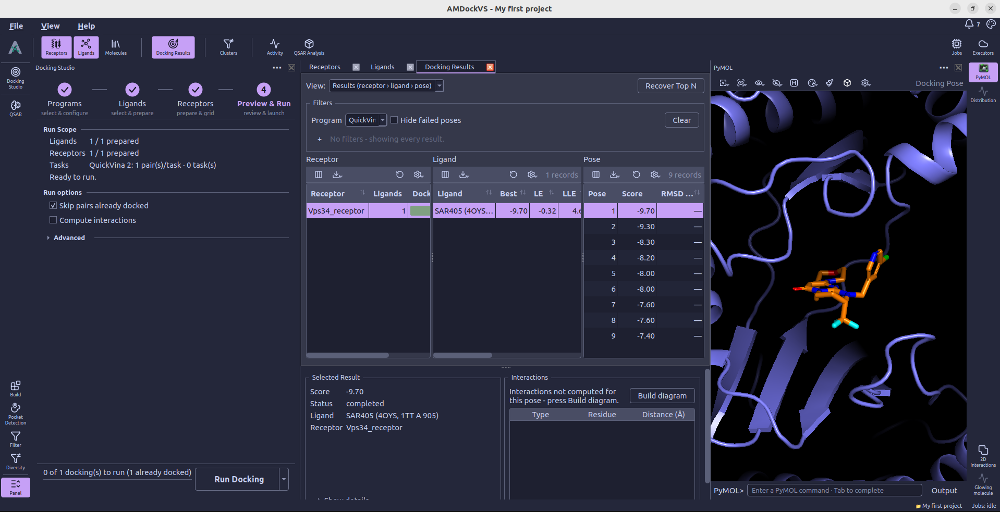
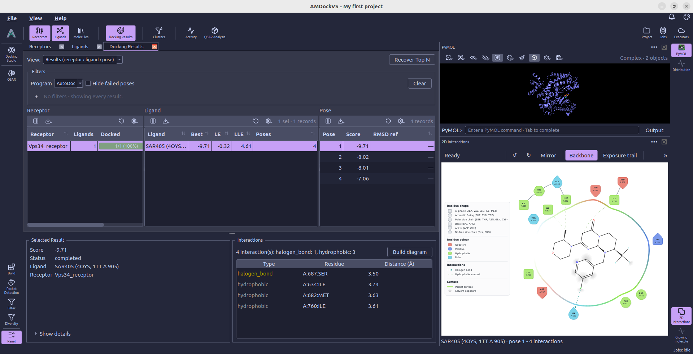
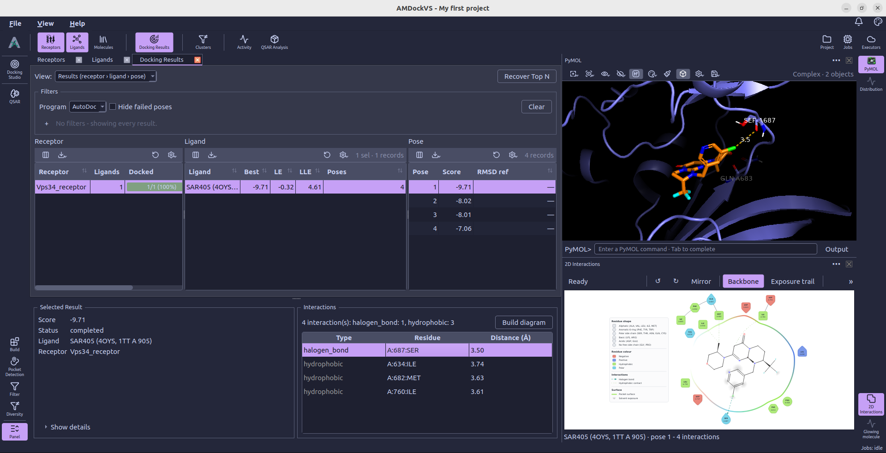
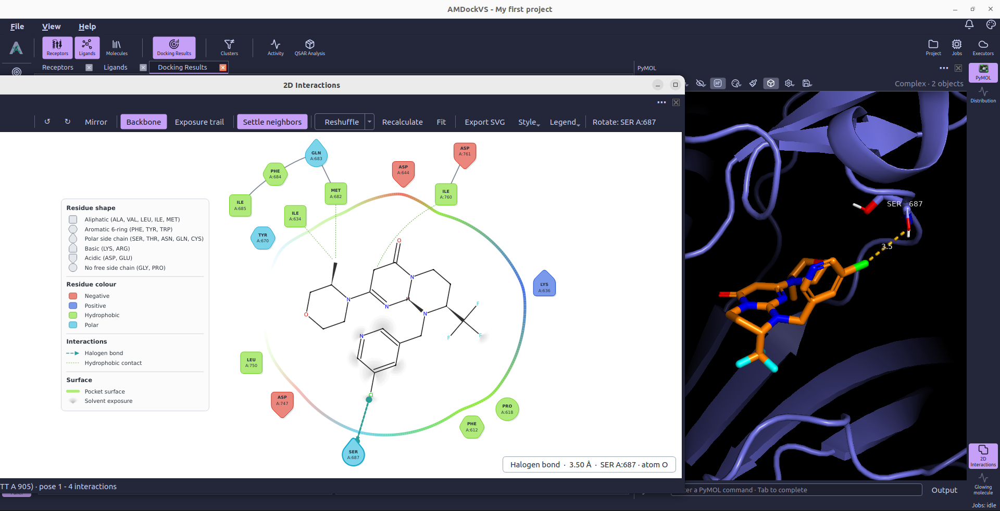

#  2D Interactions

**2D Interactions** displays a protein-ligand contact diagram for the pose
selected in **Docking Results**. Open the panel from the right tool rail.
It appears below PyMOL so that the diagram and the 3D complex can be inspected
together.

The panel follows docking poses. Selecting an undocked ligand in the Ligands
catalog does not create a contact diagram.

## 1. Select a docking pose

Open **Docking Results**, select the receptor and ligand, then choose a pose
in the pose table.

## 2. Build the diagram

Choose **Build diagram** in the selected result's **Interactions** section,
or in the 2D panel's empty-state prompt. AMDockVS detects the contacts,
calculates their diagram layout, and saves the result with that pose.

The screenshot shows the starting point for a pose without a computed
diagram. Once calculation finishes, the 2D panel opens automatically with the
contact map and reports the ligand name, pose number, and interaction count.

To analyze poses as docking finishes, enable **Compute interactions** in
[Docking Studio → Preview & Run](docking_studio.md#preview-run). This
populates the stored contact data. If a pose has no saved diagram layout,
use **Build diagram** when reviewing it.

## 3. Read contacts alongside the 3D structure

The contact map places the ligand and interacting residues in a 2D layout.
Use its legend to identify the interaction types and compare the diagram
with the selected complex in [PyMOL](pymol.md).

Select a residue in the diagram to inspect it in the 3D viewer. You can also
select a row in the result's interaction table to display that individual
contact in PyMOL. This makes it possible to check a contact's position in
the structure as well as its reported type and distance.

## 4. Adjust the diagram layout

The diagram is fully interactive, click on the three dots in the top right corner of the panel to open it in a window and access all the controls:

- Scroll to zoom and drag with the middle mouse button to pan.
- Drag a residue to reposition it in the layout.
- Use **↺** and **↻** to rotate the selected element; **Mirror** changes
  the ligand's diagram orientation.
- **Settle neighbors** adjusts the rest of the layout after rotating an
  element.
- **Reshuffle** generates another arrangement, and **Recalculate** rebuilds
  the layout.
- **Fit** fits the diagram to the panel again.

These controls edit the diagram layout; they do not move atoms in the saved
docking pose. The toolbar also provides backbone, solvent-exposure, legend,
and style controls.

## 5. Set defaults and export

Use **Defaults...** in the diagram's settings menu to open the application's
**MS-ContactMap** settings. These configure the diagram's appearance,
including glyphs, colors, and surface and exposure styling.

Choose **Export SVG...** to save the displayed diagram as a vector image.
The export reflects the current arrangement, including manual layout
adjustments. For a 3D image of the same pose, use [PyMOL's export](pymol.md#5-adjust-the-scene-and-export).
