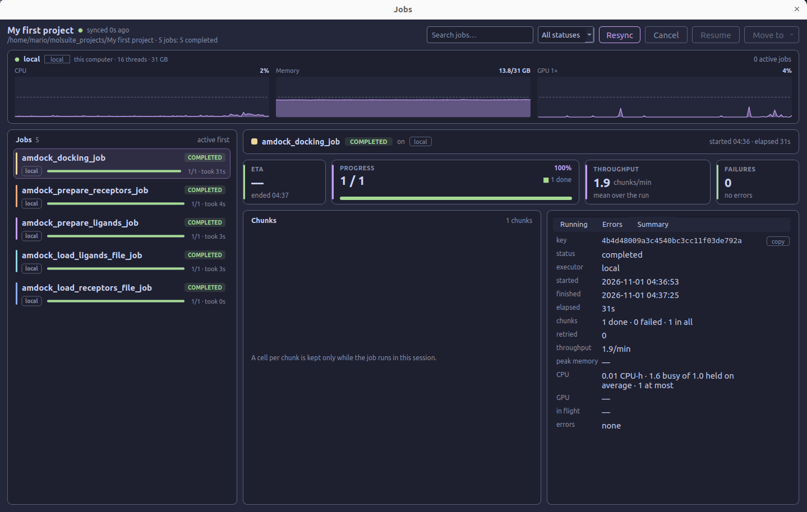

#  Jobs monitor

The **Jobs monitor** shows the background work submitted by the active
project, including imports, molecule preparation, pocket prediction,
clustering, QSAR, and docking. It opens in a separate window so you can
inspect a run while continuing to use the project workspace.

## 1. Open the monitor

Select **Jobs** on the right side of the top toolbar, or click the jobs
indicator in the status bar. Tools that provide a **See details** link can
also open the monitor for you.

Opening the window focuses running work first, with waiting work as the
fallback. An already selected running job stays selected. If filters would
hide the active job, the monitor clears them to reveal it. You can then
select another job to inspect its details.

Closing the window hides the monitor; jobs continue in the background.
Reopen it from **Jobs** whenever you need to check progress.

## 2. Find a job

The header identifies the active project and summarizes its jobs by status.
The list on the left puts active jobs first. Each entry shows the job name,
status, executor, progress, and elapsed or estimated remaining time.

Use the controls above the list to narrow what is shown:

- **Search jobs...** searches job names, IDs, statuses, and executor names.
- **All statuses** filters the list to one of the statuses present in the
  project.
- Clicking a **host card** shows the jobs assigned to that host's executors.
- Clicking the **executor name** in a selected job's detail header filters
  the list to that executor.
- The **host or executor filter chip** clears that filter when clicked.
- **Resync** requests fresh job information and reloads the selected job's
  error details.

Search, status, and host or executor filters apply together. Clear the search
and return to **All statuses** if you want to browse the full job list.

## 3. Read the job status

Select a job to display its details on the right. Its status indicates the
stage it has reached:

- **Waiting** — Submitted but not yet running.
- **Running** — Work is being executed.
- **Completed** — The job has finished successfully.
- **Completed with errors** — The job finished but reported errors; inspect
  its failures before using the results.
- **Failed** — The job could not finish successfully.
- **Canceled** — Execution was stopped by a cancellation request.
- **Interrupted** — Execution stopped before the job completed.

The detail header also identifies the executor and shows start and elapsed
times.

## 4. Follow progress and resource use

The host cards at the top show CPU, memory, and, when available, GPU activity
for the local computer and hosts used by active executors. These charts
describe the host as a whole. Queue login nodes are identified separately
and do not show resource charts.

For the selected job, the detail panel provides:

- **ETA** — An estimate of the remaining time based on recent throughput.
  It shows **calculating** until enough information is available.
- **Progress** — Completed work and the distribution of pending, running,
  done, and failed chunks.
- **Throughput** — The rate at which chunks are processed.
- **Failures** — Failed chunks and reported job errors.

A **chunk** is a unit of work submitted by a tool. Depending on the operation
and batch size, it may contain one molecule or a batch, so the chunk count
is not necessarily the molecule count.

The **Chunks** panel shows individual chunk states when those data are
available for the current session. After reopening an older run, the totals
and summary can still be available even when the individual cells are not.

## 5. Inspect running tasks and errors

### Running

The **Running** tab lists tasks currently in progress, with their input,
host, attempt number, elapsed time, and reported progress. When enough tasks
are present, the monitor highlights those taking substantially longer than
the median task time.

### Errors

The **Errors** tab groups failures by their message. Select a group to read
its recorded error or traceback below the list. Hover over a group to see
examples of affected inputs and their attempt numbers. If only part of a
large failure list has been read, the panel reports the remaining count.

Use these details to identify the input or missing requirement that needs
attention before submitting more work. **Resync** reloads the error details
if you need an updated view.

### Summary

The **Summary** tab collects the job ID, status, executor, timestamps,
elapsed time, chunk counts, retries, throughput, and available memory and
CPU/GPU usage measurements. Select **copy** beside the job key to copy its
ID when reporting a problem.

## 6. Cancel, resume, or move a job

Select a job before using the actions in the header:

- **Cancel** requests cancellation of an active job. The header reports
  whether the request was accepted or failed.
- **Resume** continues a canceled or interrupted job on the executor where
  it ran. This button is available for those stopped states.
- **Move to** lists the available destination executors for a job that can
  be continued. Moving an active job stops it first, then continues it on
  the selected executor. If continuation is unavailable, the menu reports
  that the job cannot be continued.

Action availability depends on the job's state and execution context.
If an action fails, read the message beside the project title. Use the
application's **Executors** window to start or stop executors.

## 7. Return to the results

When a job finishes, return to the tool or result view that submitted it:
for example, [Docking Results](docking_studio.md#results),
[QSAR Analysis](qsar.md#analyze-models), or
[Clusters](diversity.md#5-choose-representatives). For preparation and import
jobs, inspect the updated records in the molecule catalogs.
