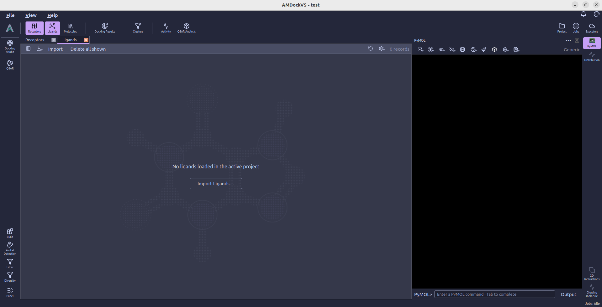
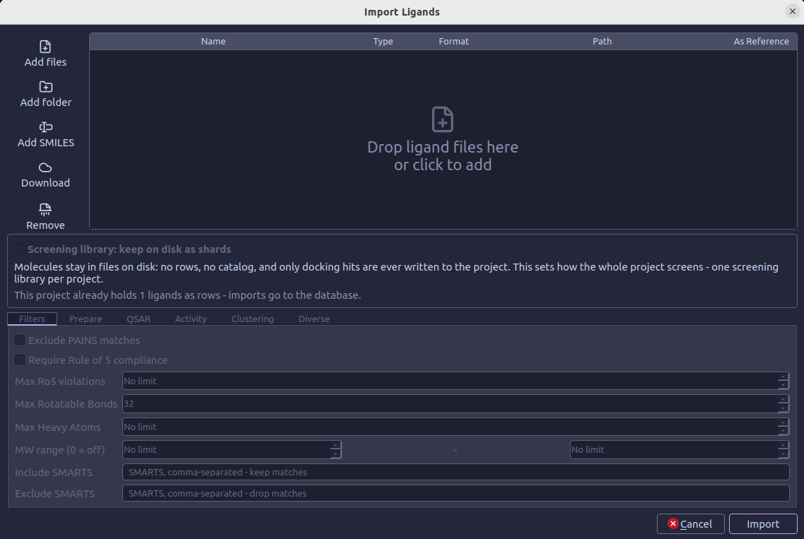
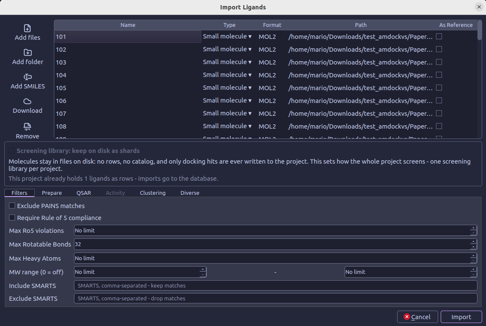
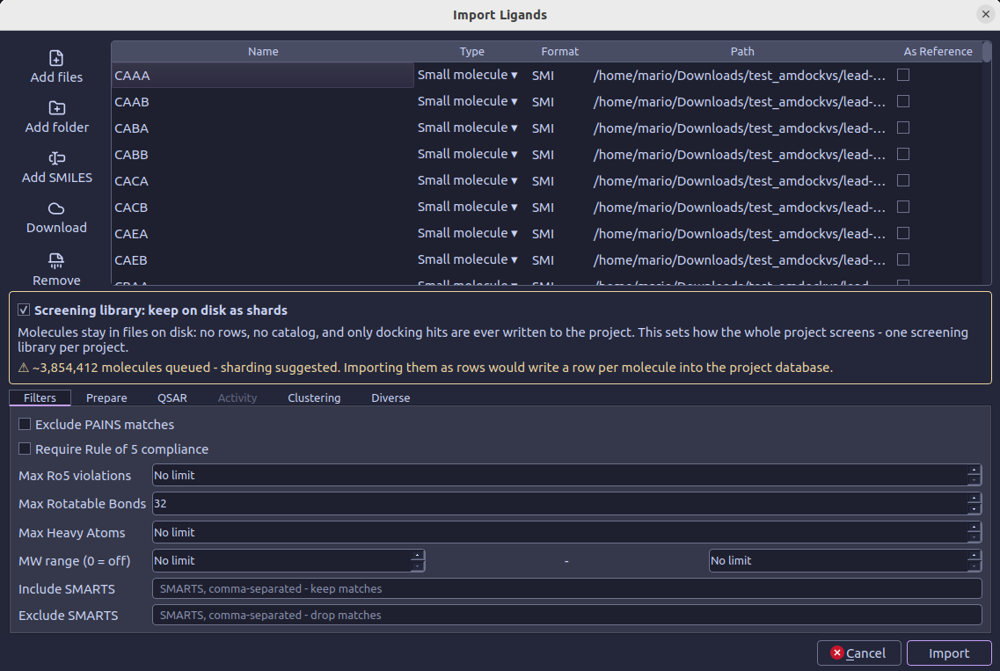

#  Ligands

The **Ligands** catalog contains molecules imported into the active project.
Choose **Import Ligands...** in the catalog, or use **File → Import Ligands...**, to open
the import panel. From there, add files or download compounds, set a molecule
type for each file, and choose whether small molecules should be stored as
project rows or kept as a screening library on disk.

## Add ligand files

Use the toolbar beside the table to add inputs:

-  **Add files** — Select one or more molecule files. Supported inputs include SDF/SD, MOL/MDL, MOL2, PDB, PDBQT, CIF/mmCIF, SMILES, CSV/TSV/text tables, and FASTA files.
-  **Add folder** — Add supported files from a folder and its subfolders.
-  **Add SMILES** — Paste one SMILES per line, optionally followed by a molecule name. AMDockVS saves the input as a temporary `.smi` file for import.
-  **Download** — Retrieve compounds from PubChem by CID or name, ChEMBL by compound ID, the ChEMBL approved-drug collection, the latest eMolecules free catalog, or URLs such as ZINC22 tranche and vendor files.
-  **Remove** — Remove selected files from this pending import.

You can also drag files or folders onto the table. Duplicate paths are added
only once. Downloaded files can be kept for reuse on a later import; temporary
downloads are removed after import, and project downloads can be reviewed in
**Settings → Downloads**.

## Review the input table

The table has one row per input file:

| Column | What it controls |
| --- | --- |
| **Name** | The displayed file or downloaded compound-set name. |
| **Type** | Choose **Small molecule**, **Protein**, **Peptide**, **Nucleotide**, or **Polymer**. New rows default to **Small molecule**. |
| **Format** | The file extension detected for the input. |
| **Path** | The source file location. |
| **As Reference** | Mark curated ligands, such as co-crystals or measured actives, as references. Reference files are imported as project rows and are not placed in screening shards. The Activity tab reads measurements only from files marked this way. |

Click a **Type** cell to select its molecule type. Click anywhere in an **As
Reference** cell to toggle that mark.

## Choose where a screening library goes

The **Screening library: keep on disk as shards** option is for large
small-molecule collections. When enabled, molecules remain in files on disk
instead of becoming one database row per molecule; docking hits are written to
the project. Reference files and non-small-molecule types still import as
rows. AMDockVS suggests sharding when the queued small-molecule count reaches
its configured threshold.

A project can have one screening library. If a project already has ligand rows,
new imports go to the project database. If it already has a sharded library,
the option stays selected for additional screening files. Turn it off for a
row-based import, and mark curated files **As Reference** to put them in the
reference context.

## Set import options

The tabs below the table apply to small-molecule inputs. They become available
when at least one file is assigned the **Small molecule** type.

### Filters

All filters are optional and are off unless stated otherwise. The **Max
Rotatable Bonds** field starts at 32; `0` means no limit. The other numeric
limits use `0` for no limit.

- **Exclude PAINS matches** — Remove molecules matching PAINS substructure
  patterns.
- **Require Rule of 5 compliance** — Keep molecules with no more than the
  selected maximum number of Lipinski Rule of 5 violations. The default is no
  maximum.
- **Max Rotatable Bonds** — Set the upper limit on rotatable bonds.
- **Max Heavy Atoms** — Set the upper limit on heavy atoms.
- **MW range** — Set a lower and/or upper molecular-weight bound.
- **Include SMARTS** — Keep molecules matching every comma-separated SMARTS
  pattern.
- **Exclude SMARTS** — Remove molecules matching any comma-separated SMARTS
  pattern.

### Prepare

Each preparation option is off by default and runs only when the corresponding
feature is missing:

- **Add hydrogens (if missing)** — Add explicit hydrogens when absent.
- **Generate 3D coordinates (if missing)** — Generate a 3D conformer using
  ETKDG; this also adds hydrogens and can take time for very large libraries.
- **Standardize to canonical tautomer** — Select one canonical tautomer per
  molecule. This does not enumerate tautomers as separate molecules.
- **Split fragments into separate molecules** — Keep the largest organic
  fragment as the main molecule and import other distinct organic fragments as
  separate molecules; duplicate fragments and ions are skipped.

### QSAR, Clustering and Diverse

These tabs are placeholders in the import panel. QSAR model filtering is not
available during import. Clustering and diversity selection run after import;
use **Molecule Tools → Diversity** for those operations.

### Activity

The **Activity** tab is enabled only when at least one input is marked **As
Reference**. Enter an SDF property tag or table column under **Activity from
file tag/column**. The optional endpoint name defaults to that tag; the unit
can be selected or entered, and the transform can be left as **(none)** or set
to **pIC50**, **pKi**, or **pEC50**.

For a reference CSV, TSV, text, or SMILES table, the panel detects numeric
columns and offers them as checkboxes. Select the columns to import as activity
endpoints. Columns containing only 0 and 1 are identified as categorical; other
numeric columns are identified as continuous. Detected columns are not selected
automatically.

## Start the import

Add at least one file, review its type and reference status, and select
**Import**. The options in the tabs apply to small-molecule files; other types
are imported using their selected type. Reference small molecules are loaded
as project rows, while non-reference small molecules can be sent to the
screening shards when that option is selected. Follow the submitted work in
the [Jobs monitor](jobs_monitor.md); AMDockVS opens the Ligands catalog or the Shards view based
on where the imported molecules are stored.
