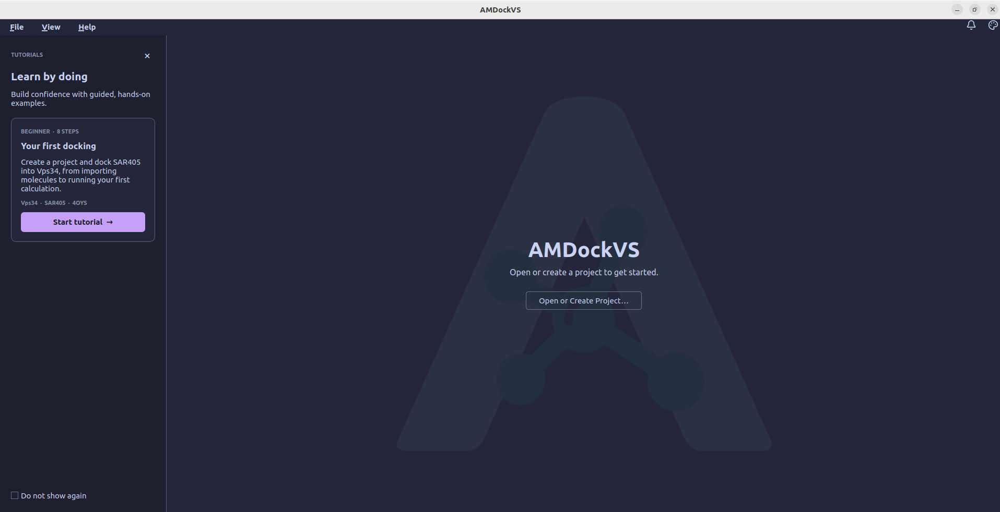
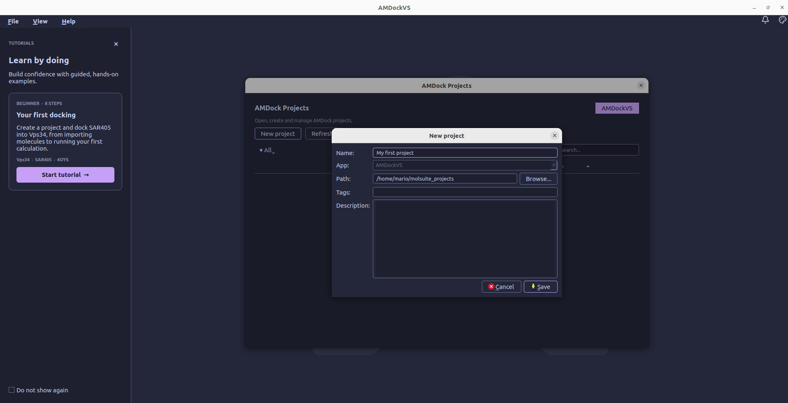

# Main page

The main page appears when AMDockVS starts without an open project. The center
of the window contains the project controls, while the tutorial card stays
visible alongside them. From here, you can open an existing project, create a
new one, or start the guided docking example.

## Projects

Select **Open or Create Project...** to open the AMDock projects dialog. It
lists the projects registered with AMDockVS so you can choose one to open or
create a new project. Use __New project__ to enter a name and storage folder;
you can also add tags and a description to help identify the project later.
After you save, AMDockVS opens the new project in the workspace.

An AMDockVS project represents one docking study or screening campaign. It
groups the molecule records, settings, jobs, and results for that work in one
project folder. Its main files are:

- `project.db`, a SQLite database containing molecule records, sets, binding
  sites, docking results, and interactions.
- `volumes/` stores structure data such as imported molecules, prepared
  inputs, and docking poses. The database keeps references to these structures.
- `executor.db` records job state.
- `config.toml` stores project-specific settings.

Folders for models, pockets, shards, and docking artifacts are added as those
features are used. See [Where your data lives](data_and_export.md) for the full
folder layout and backup guidance.

## Tutorial

The **Your first docking** card starts an eight-step, hands-on walkthrough
using the Vps34 receptor and SAR405 ligand. It guides you through creating a
practice project, importing the example molecules, opening Docking Studio,
choosing AutoDock Vina, preparing the ligand and receptor, defining the docking
box, and launching the calculation. You perform each action in the application
as the tutorial guides you through the workflow. The tutorial ends when the
docking job is submitted; poses and scores appear in **Docking Results** after
the calculation finishes.
