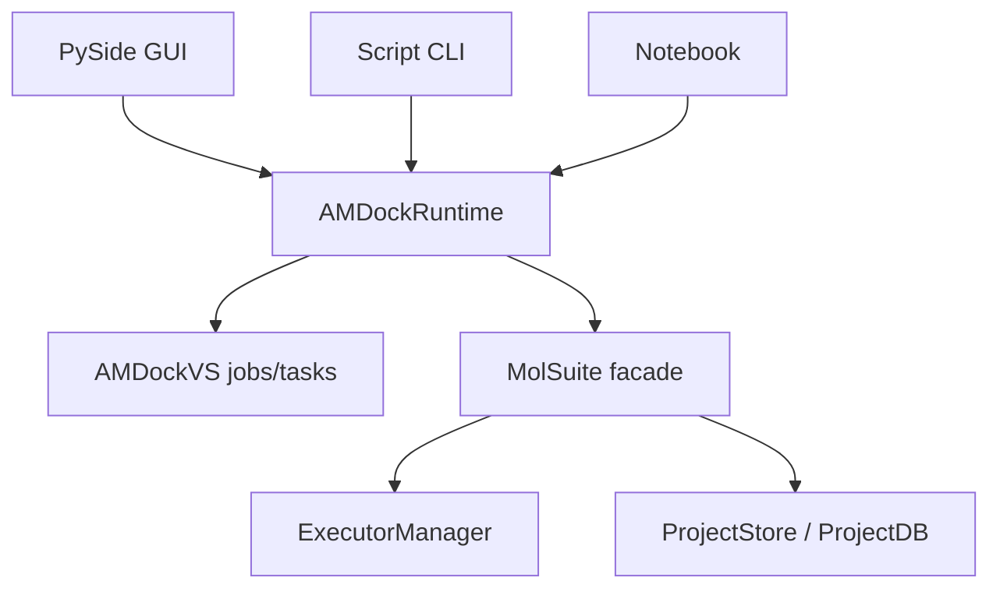
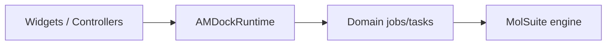
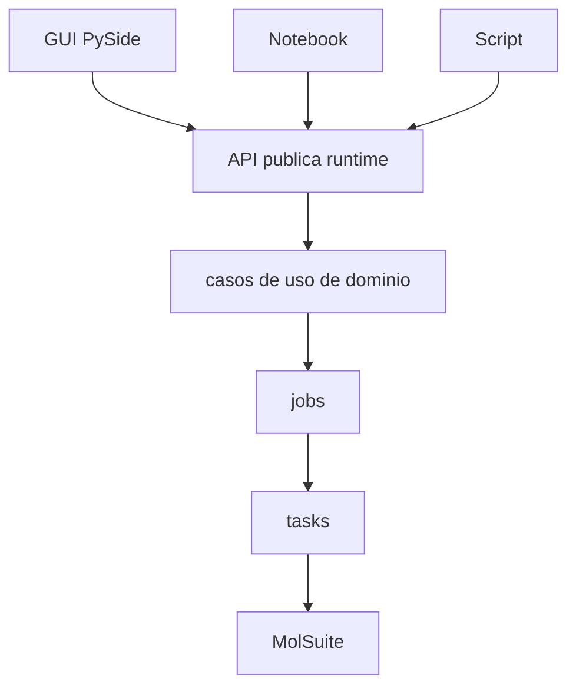
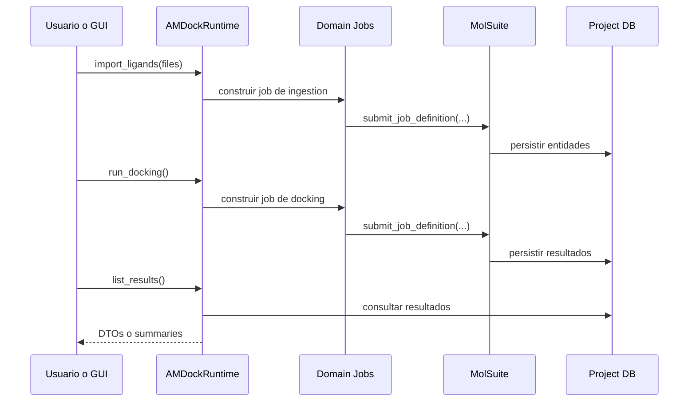

# Observaciones y Propuestas de Diseno para AMDockVS

Nota:

- este documento conserva parte del lenguaje del refactor anterior
- donde diga `AMDockRuntime`, léase `AMDockVSRuntime`
- la ruta pública vigente es `from amdock import AMDockVSRuntime`

Este documento resume observaciones sobre la evolucion de `AMDockVS` sobre `MolSuite`, con foco en runtime, API Python, independencia de la GUI y direccion de arquitectura.

## 1. Objetivo arquitectonico de AMDockVS

La direccion correcta para `AMDockVS` es esta:

- la GUI en PySide debe consumir un runtime de dominio
- los scripts deben consumir ese mismo runtime
- los notebooks deben consumir ese mismo runtime
- la logica de orquestacion y persistencia no debe vivir dentro de la GUI

En otras palabras, `AMDockVS` debe ser una app de dominio con una Python API clara y estable, donde la GUI sea solo un cliente mas.

## 2. Estado general actual

`AMDockVS` ya va en la direccion correcta porque su `AMDockRuntime` no depende de PySide y encapsula operaciones de dominio como:

- crear y abrir proyectos
- cargar ligandos y receptores
- lanzar jobs registrados
- esperar resultados
- listar entidades y resultados

Eso lo convierte en una base valida para backend reutilizable.

Fortalezas actuales:

- El runtime ya es agnostico de UI.
- El pipeline backend se puede usar desde tests y scripts.
- La frontera entre app de dominio y motor base esta razonablemente clara.
- `jobs` y `tasks` ya representan operaciones del dominio de docking.

Limitaciones actuales:

- La API todavia mezcla contratos de dominio con detalles del engine.
- El runtime devuelve tipos heterogeneos y muy cercanos al storage.
- Algunas piezas siguen teniendo caracter de demo en vez de API final.
- La experiencia de uso aun no esta cerrada como API Python oficial.

## 3. Relacion recomendada entre GUI, runtime y backend



Principio clave:

- `AMDockRuntime` es la frontera publica de la aplicacion.
- La GUI no debe hablar directamente con `ExecutorManager`, `ProjectStore` o tablas SQL si puede evitarlo.

## 4. Observaciones principales y solucion propuesta

### 4.1. El runtime debe ser la API oficial de AMDockVS

Observacion:

- Hoy `AMDockRuntime` ya centraliza el backend de dominio.
- Eso es correcto y debe consolidarse como contrato publico.

Solucion propuesta:

- Declarar explicitamente que la API publica de `AMDockVS` es el runtime.
- Hacer que GUI, scripts, notebooks y tests usen la misma capa.
- Evitar que nuevas features entren primero por la GUI.

Regla recomendada:

- si una operacion de negocio no existe en `AMDockRuntime`, todavia no existe como API de AMDockVS.

### 4.2. La GUI debe ser cliente, no contenedor de logica

Observacion:

- Como `AMDockVS` apunta a PySide, existe el riesgo de mover logica de negocio a widgets, handlers o actions de interfaz.

Riesgo:

- duplicacion de logica
- acoplamiento fuerte a UI
- menor testabilidad
- notebooks y scripts de segunda clase

Solucion propuesta:

- Mantener este criterio de capas:



Regla de oro:

- la GUI puede coordinar flujo de usuario
- el runtime coordina flujo de dominio
- las tasks hacen trabajo computacional
- el engine orquesta ejecucion y persistencia

### 4.3. La API Python aun debe estabilizarse mejor

Observacion:

- La API actual es util, pero todavia esta centrada en operaciones backend basadas en jobs registrados.
- Para uso en notebooks y scripting seria deseable una API mas expresiva y menos cercana a detalles internos.

Solucion propuesta:

- Consolidar una API de alto nivel orientada a casos de uso.

Ejemplo de direccion:

```python
runtime = AMDockRuntime()
project = runtime.create_or_open_project(name="demo", folder="./demo_project")

runtime.loader.load_ligands(["ligands.sdf"])
runtime.loader.load_receptors(["receptor.pdb"])
runtime.qsar.compute_descriptors()
runtime.docking.run(box_center=(0.0, 0.0, 0.0), box_size=(20.0, 20.0, 20.0))

results = runtime.docking.list_results()
```

La idea no es cambiar el motor interno, sino ofrecer una API publica mas legible sobre las operaciones ya oficiales.

### 4.4. El runtime debe devolver objetos de dominio, no solo filas del storage

Observacion:

- Hoy varias operaciones terminan exponiendo listas de `SQLModel` o diccionarios muy cercanos a la persistencia.

Riesgo:

- la API publica queda acoplada al esquema interno
- cambios de tabla impactan mas de la cuenta a consumidores externos

Solucion propuesta:

- Introducir DTOs o modelos Pydantic para la API publica.
- Dejar `SQLModel` como detalle interno de persistencia.

Direccion sugerida:

- `LigandSummary`
- `ReceptorSummary`
- `DescriptorSummary`
- `DockingResultSummary`
- `JobStatus`
- `ProjectSummary`

## 5. Problemas concretos detectados

### 5.1. Riesgo de abrir proyectos de otras apps

Observacion:

- `AMDockRuntime` hereda el comportamiento de `BaseRuntime`.
- Si el aislamiento por `app_id` no se endurece en `MolSuite`, `AMDockVS` puede terminar operando sobre proyectos ajenos.

Solucion propuesta:

- Endurecer `BaseRuntime` en `MolSuite`.
- En `AMDockVS`, asumir explicitamente que solo se opera sobre proyectos con `APP_ID` propio.

### 5.2. Los jobs de dominio siguen muy cerca de SQLModel

Observacion:

- Los jobs de descriptores y docking usan `ProjectStore` con modelos `LigandRecord` y `ReceptorRecord` para construir chunks.

Riesgo:

- el dominio queda muy atado a la representacion de tabla
- se limita el valor del sistema de `InputSpec`

Solucion propuesta:

- Introducir una capa intermedia de consultas de dominio.
- Por ejemplo:
  - `runtime.iter_ligand_inputs(...)`
  - `runtime.iter_receptor_inputs(...)`
  - helpers de consultas locales por feature o en `amdockvs.api.queries`
- A mediano plazo, migrar parte del chunking a contratos de datos mas desacoplados.

### 5.3. Algunos entrypoints aun son de demostracion, no de producto

Observacion:

- Hay scripts y entrypoints que todavia usan rutas hardcodeadas o flujo de demo.

Impacto:

- la experiencia real de CLI/API queda ambigua
- cuesta distinguir lo experimental de lo estable

Solucion propuesta:

- Separar claramente:
  - `examples/` o scripts demo
  - CLI real
  - API publica del runtime
- Todo entrypoint de producto debe depender de argumentos reales o configuracion explicita.

## 6. Diseno recomendado de la Python API

### 6.1. Capa publica del runtime

Metodos deseables como contrato estable:

- `create_project(...)`
- `open_project(...)`
- `create_or_open_project(...)`
- `get_project_paths()`
- `import_ligands(...)`
- `import_receptors(...)`
- `calculate_descriptors(...)`
- `run_docking(...)`
- `wait_for_jobs(...)`
- `cancel_job(...)`
- `get_job_status(...)`
- `list_ligands(...)`
- `list_receptors(...)`
- `list_descriptors(...)`
- `list_results(...)`
- `get_results_dataframe()` o una utilidad equivalente, si aparece una necesidad real

### 6.2. Segmentacion de responsabilidades



Regla recomendada:

- `jobs` y `tasks` son implementacion interna del backend.
- La mayoria de usuarios no deberia invocarlos directamente.

### 6.3. DTOs sugeridos para la API

Ejemplos de tipos publicos deseables:

```python
class LigandSummary(BaseModel):
    external_id: str
    name: str
    stored_path: str
    status: str

class DockingResultSummary(BaseModel):
    ligand_external_id: str
    receptor_external_id: str
    score: float
    output_path: str
    status: str
```

Beneficio:

- una API mas estable
- menos dependencia del storage interno
- mas claridad para notebooks, servicios y GUI

## 7. Flujo objetivo de uso



## 8. Prioridades de mejora para AMDockVS

### Prioridad alta

- Consolidar `AMDockRuntime` como API oficial.
- Evitar que la GUI implemente logica de negocio.
- Definir DTOs o modelos publicos de salida.
- Limpiar entrypoints de demo y separar ejemplos de producto.

### Prioridad media

- Introducir wrappers mas expresivos sobre jobs registrados.
- Reducir el acoplamiento directo a `SQLModel` en chunking de dominio.
- Mejorar observabilidad del runtime para GUI y notebooks.

### Prioridad baja

- Agregar utilidades de exportacion a DataFrame o CSV.
- Crear recetas listas para notebooks.
- Refinar nombres de metodos y consistencia semantica.

## 9. Criterios de exito

Se considerara que `AMDockVS` ya tiene una Python API bien definida cuando:

- la GUI use exclusivamente el runtime para negocio
- un notebook pueda ejecutar el flujo principal sin tocar detalles de engine
- scripts y tests reutilicen exactamente la misma capa publica
- la API devuelva objetos de dominio estables
- `jobs` y `tasks` queden como backend interno y no como interfaz primaria

## 10. Conclusiones

`AMDockVS` no debe pensarse como una GUI con backend embebido, sino como una aplicacion de dominio con backend reutilizable y GUI opcional.

La direccion correcta es:

- `MolSuite` como engine
- `AMDockRuntime` como API publica de dominio
- GUI, notebooks y scripts como clientes equivalentes

Eso mejora mantenimiento, testabilidad, reutilizacion y claridad del producto.
