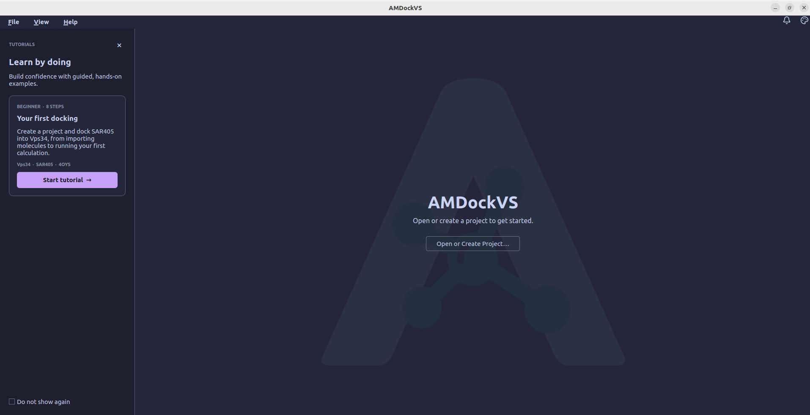
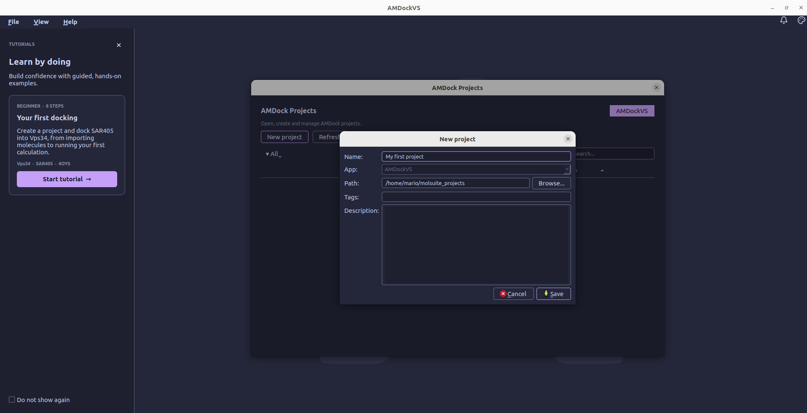
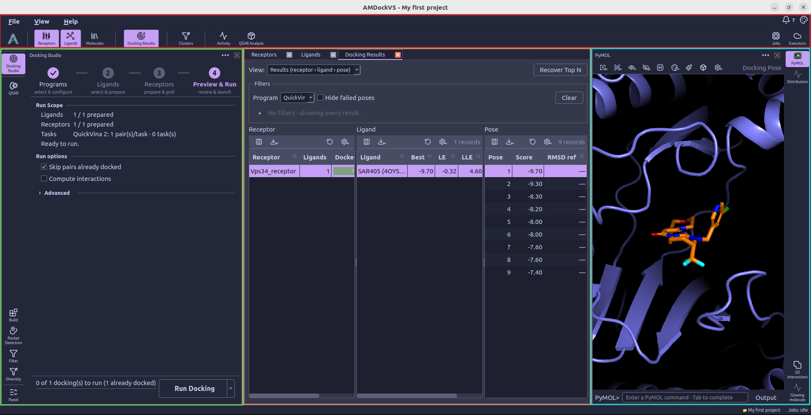

# Overview

## Main page

The main page appears when AMDockVS starts without an open project. The center
of the window contains the project controls, while the tutorial card stays
visible alongside them. From here, you can open an existing project, create a
new one, or start the guided docking example.

## Projects

Select **Open or Create Project...** to open the AMDock projects dialog. It
lists the projects registered with AMDockVS so you can choose one to open or
create a new project. Use __New project__ to enter a name and storage folder;
you can also add tags and a description to help identify the project later.
After you save, AMDockVS opens the new project in the workspace.

An AMDockVS project represents one docking study or screening campaign. It
groups the molecule records, settings, jobs, and results for that work in one
project folder. Its main files are:

- `project.db`, a SQLite database containing molecule records, sets, binding
  sites, docking results, and interactions.
- `volumes/` stores structure data such as imported molecules, prepared
  inputs, and docking poses. The database keeps references to these structures.
- `executor.db` records job state.
- `config.toml` stores project-specific settings.

Folders for models, pockets, shards, and docking artifacts are added as those
features are used. See [Where your data lives](data_and_export.md) for the full
folder layout and backup guidance.

## Workspace

AMDockVS opens projects in a dockable, multi-panel workspace. Each workspace contains three main areas:

- The **top catalog and result views in the center** open as tabs (_e.g._, receptors and ligands tabs, docking results)
- The **left tool rail** opens one task panel at a time (_e.g._, docking studio, QSAR)
- The **right tool rail** open visualization panels (_e.g._, PyMOL, 2D contacts)

Next, we describe the tools and panels available in AMDockVS.

### Top catalog

-  **[Receptors](receptors.md)** — Import one or more receptor structures from databases or local files.
-  **[Ligands](ligands.md)** — Import ligand files, set molecule types, and choose whether to store a screening library as shards.

### Main analysis tools

-  **[Docking Studio](docking_studio.md)** — Configure docking programs, prepare molecules and launch runs.
-  **[QSAR](qsar.md)** — Build models from activity data and apply them to ligands or screening libraries.

### Secondary analysis tools

-  **[Build](build.md)** — Prepare small molecules and proteins, including 3D conformer generation.
-  **[Pocket Detection](pocket_detection.md)** — Predict potential binding sites.
-  **[Filter](filter.md)** — Apply criteria to small-molecule records.
-  **[Diversity](diversity.md)** — Cluster compounds by molecular similarity and choose representatives.

### Visualization tools

-  **[PyMOL](pymol.md)** — Visualize molecules and their interactions in 3D.
-  **[2D Interactions](interactions_2d.md)** — Inspect molecular interactions in 2D diagrams.

### Job monitoring

-  **[Jobs monitor](jobs_monitor.md)** — Follow background jobs, inspect progress and errors, and cancel, resume, or move work between executors.

## Tutorial

The **Your first docking** card starts an eight-step, hands-on walkthrough
using the Vps34 receptor and SAR405 ligand. It guides you through creating a
practice project, importing the example molecules, opening Docking Studio,
choosing AutoDock Vina, preparing the ligand, defining and activating the docking
box, preparing the receptor, and launching the calculation. You perform each
action in the application as the tutorial guides you through the workflow.
The tutorial ends when the docking job is submitted; poses and scores appear in
**Docking Results** after the calculation finishes.

Watch the complete tutorial, from creating a practice project and importing the
example molecules to defining the docking box, running docking, and viewing the
poses and scores.

<iframe src="https://www.youtube-nocookie.com/embed/HjT4PxUy0yg" title="AMDockVS guided docking tutorial" style="width: 100%; aspect-ratio: 16 / 9; border: 0;" allow="accelerometer; clipboard-write; encrypted-media; gyroscope; picture-in-picture; web-share" referrerpolicy="strict-origin-when-cross-origin" allowfullscreen></iframe>
