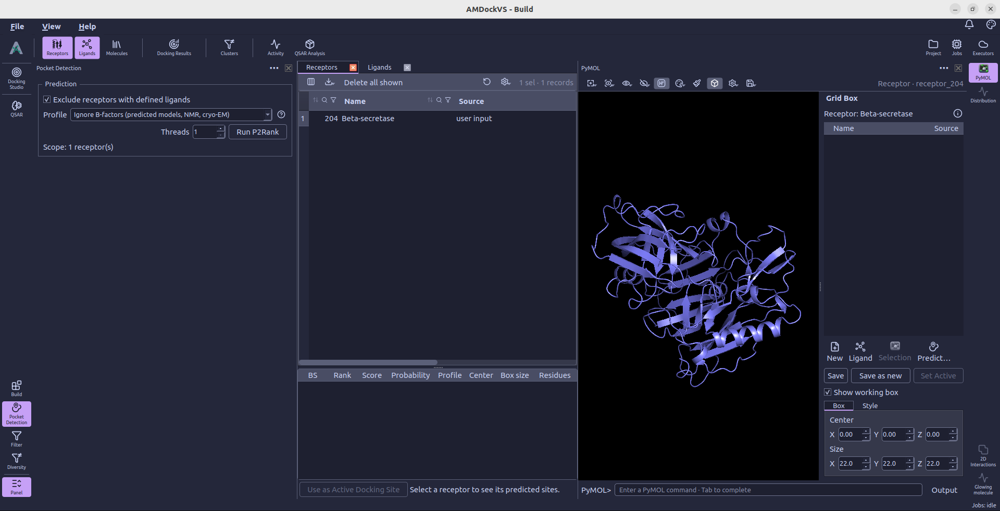
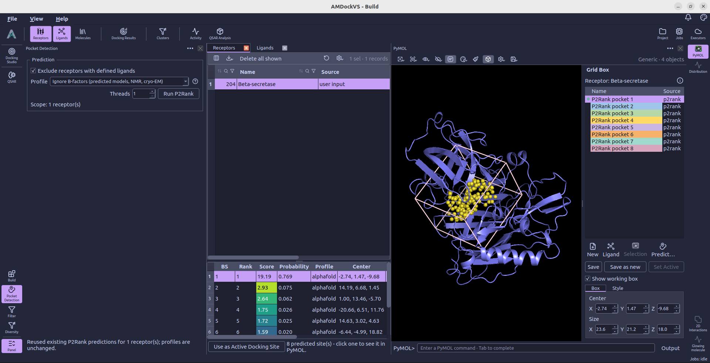

#  Pocket Detection

**Pocket Detection** runs [P2Rank](https://github.com/rdk/p2rank) on receptor structures and stores the predicted
binding sites in the project. Open it from the left tool rail. The Receptors
catalog supplies the structures to process, and the Binding Sites view shows
the predictions for the receptor you are inspecting.

## 1. Choose receptors

The run uses the current receptor-table scope, including table filters and the
global receptor selection. The **Scope** line in the tool shows how many
receptors will be processed.

**Exclude receptors with defined ligands** is checked by default. It hides
receptors whose import metadata already contains reference ligands. Clear
this option to predict pockets for those receptors as well. If the resulting
scope is empty, adjust this option or the filters in the Receptors catalog.

## 2. Set prediction options

- **Profile** — Choose **Ignore B-factors (predicted models, NMR, cryo-EM)**
  (the default) or **Use B-factors (X-ray structures)**. The selected profile
  applies to the whole run, including runs containing a mixture of structure types.
- **Threads** — Set the number of CPU threads used by P2Rank.

**Ignore B-factors (predicted models, NMR, cryo-EM)** is AMDockVS's default.
It uses P2Rank's AlphaFold prediction model, which keeps the chemical and
geometric features but omits B-factors. Keep this option when B-factors are
missing, uncertain, or contain prediction confidence scores. It also provides
a fallback for mixed collections whose B-factor provenance is uncertain.
[P2Rank recommends this model](https://github.com/rdk/p2rank/tree/2.5.1#predict-ligand-binding-sites-p2rank-algorithm)
for AlphaFold models and NMR or cryo-EM structures.
For example, AlphaFold PDB files store
[pLDDT confidence scores](https://alphafold.ebi.ac.uk/faq) in the B-factor field;
these values have a different meaning from experimental X-ray B-factors.

The B-factor-free profile also uses its own score-to-probability calibration.
Changing profiles can therefore change the predicted pockets, their ranking,
scores, and probabilities for the same receptor coordinates.

**Use B-factors (X-ray structures)** uses P2Rank's standard prediction model,
which combines chemical and geometric features of the protein surface with
atomic **B-factors**. Choose this profile for X-ray crystal structures with
meaningful experimental B-factors.

The differences between the two profiles are defined in P2Rank's
[Standard](https://github.com/rdk/p2rank/blob/2.5.1/distro/config/default.groovy)
and [AlphaFold](https://github.com/rdk/p2rank/blob/2.5.1/distro/config/alphafold.groovy)
configurations.

P2Rank and Java 17 or later must be available. When the runtime is missing,
the **P2Rank Runtime** section reports its status and provides **Open Settings**
to reach **Settings → External tools**.

Each run adds its pockets next to the earlier ones; a run with another profile
does not replace them. The **Profile** column of the results table tells the
runs apart, and the receptor's active docking site stays as it is until you
choose another. Running the profile of a receptor's latest run again reuses
those results instead of calculating them again.

## 3. Run P2Rank

Select **Run P2Rank**. While prediction is running, the status line reports
progress and **See details** opens the [Jobs monitor](jobs_monitor.md). The tool prevents another
prediction run from being submitted while its current work is active.

When the job finishes, select a receptor in the Receptors catalog to inspect
its predicted sites in the Binding Sites view.

## 4. Inspect predicted sites

The results table lists the binding-site ID (**BS**), rank, score, probability,
profile, box center, box size, and pocket residues. The **Score** cells use
the same colors as the pockets in PyMOL: violet for lower scores and yellow
for higher scores within that receptor's predictions.

Select one or more site rows to display their pocket points and centers on
the receptor in [PyMOL](pymol.md). The binding-site presets there let you
switch between points, nearby residues, and a local surface.

## 5. Use a site for docking

Select the site you want and choose **Use as Active Docking Site**. This makes
that site's box the active docking search space for the receptor. Selecting
rows to visualize pockets does not activate them for docking by itself.

Review the box in PyMOL's **Grid Box** panel or in
[Docking Studio → Receptors](docking_studio.md#receptors), adjust it if needed,
and prepare the receptor before launching docking.
