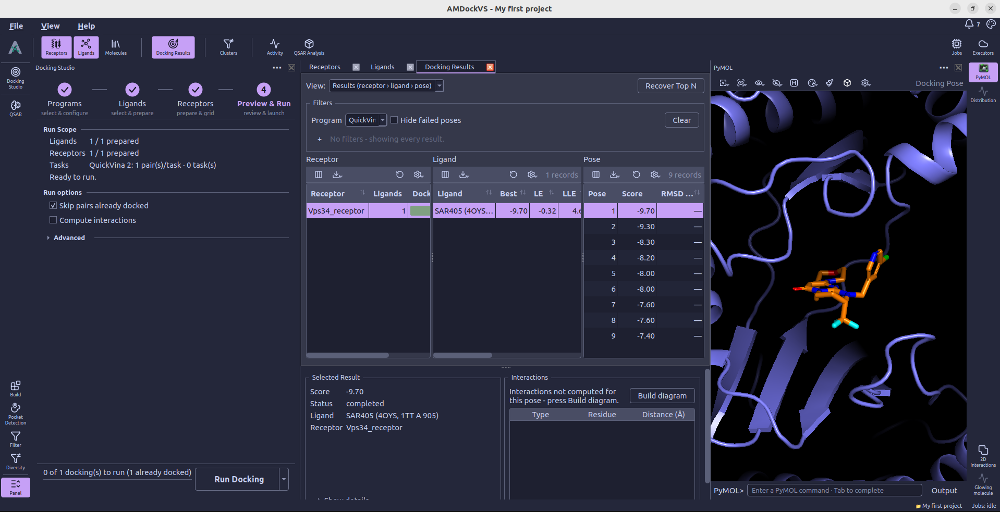
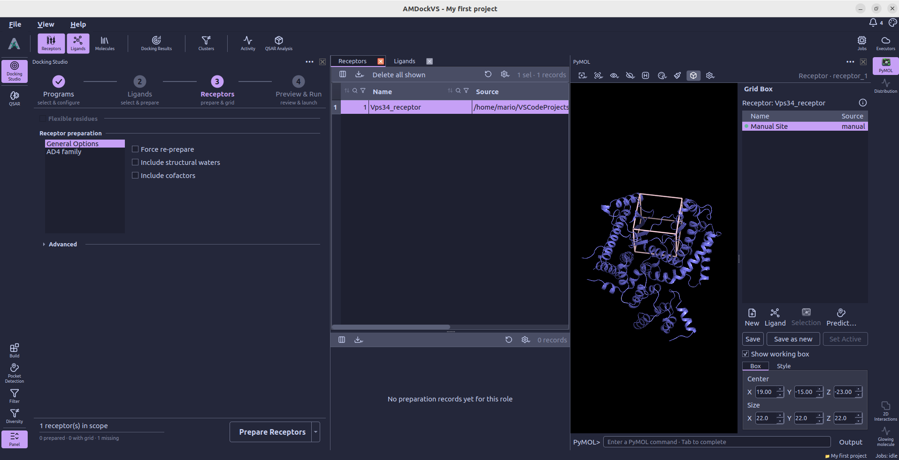

#  PyMOL

**PyMOL** is the embedded 3D viewer on the right side of the workspace. It
shows receptor structures, ligands, docking poses, and binding-site boxes.
Open it from the right tool rail, then select a molecule or docking pose in
the central catalog to inspect it.

## 1. Choose what to display

The viewer follows the structure selected in the active catalog or result
view. Select a receptor to inspect its structure and active binding site,
a ligand to inspect that molecule, or a pose in **Docking Results** to see
the receptor–ligand complex.

In [Pocket Detection](pocket_detection.md), selecting predicted sites displays
their pocket points and centers on the receptor. The available display
presets change with the kind of scene being shown.

PyMOL displays the coordinates stored for the selected molecule. To generate
a 3D structure or change its preparation, use [Build](build.md) or
[Docking Studio](docking_studio.md).

For an ESMFold prediction, open the bottom **Panel** and choose **Color by
pLDDT**. The prediction and confidence data remain saved when you reopen the
project. After structure preparation, **Color prediction by pLDDT** displays
the saved prediction with its original confidence values; **Show Current**
returns to the prepared working structure.

## 2. Use the viewer toolbar

The toolbar provides the following actions. In a narrow panel, some actions
move into its overflow menu.

-  **Selection** — Choose whether mouse picks select atoms, residues, chains, or objects. The menu also clears the PyMOL selection.
-  **Actions** — Use **Zoom**, **Orient**, or **Center** on the current PyMOL selection or scene target.
-  **Display** — Apply Cartoon, Sticks, Lines, Surface, Spheres, Ribbon, or Dots. In comparison scenes, the menu also offers Grid and Overlay layouts.
-  **Hide** — Hide a representation or everything for the current selection or scene target.
-  **Hydrogens** — Show polar hydrogens (bonded to N, O, or S) by default. Click to cycle through hidden, all, and polar hydrogens in the PyMOL session.
-  **Presets** — Apply a display preset compatible with the current scene.

The atom or residue selection made inside PyMOL controls viewer actions. The
global molecule selection used by Build and Docking Studio is made separately
in the catalog tables.

## 3. Choose a display preset

AMDockVS adds presets for the main kinds of scene:

- **AMDock · Receptor** shows the receptor as a cartoon with atom coloring
  based on its role.
- **AMDock · Ligand** centers the ligand and shows it as sticks.
- **AMDock · Protein-ligand** shows the protein as a cartoon and the ligand
  or docking pose as sticks.
- **Binding sites · Points**, **Binding sites · Residues**, and
  **Binding sites · Surface** show different views of a predicted pocket.
- **Surface · Site highlight** and **Surface · Residue nature** show the
  search-space region on a receptor surface, using either a highlight color
  or residue chemical properties.

The menu only offers presets that apply to the current scene. Select a
predicted pocket first to use its binding-site presets.

## 4. Inspect the search space

**Grid Box** opens the side panel beside the 3D canvas. Select a receptor
to review its sites and the center and dimensions of its working box. The
panel's save and activation actions control which site is used for docking.

Use [Pocket Detection](pocket_detection.md) to predict candidate sites, or
review the receptor's active box during the
[Receptors step of Docking Studio](docking_studio.md#receptors).

## 5. Adjust the scene and export

**Scene** provides additional scene, camera, and rendering options.
**Color by Role** distinguishes receptor and ligand atoms while keeping
heteroatoms colored by element. **Clear Scene** removes the displayed objects
from PyMOL; it does not delete their project records. The command line beneath
the canvas accepts PyMOL commands for further adjustments.

**Export** offers **Save displayed complex as PDB...** and
**Save ray-traced PNG...**. The image export uses a print-sized rendering at
300 dpi.

For a complementary view of the selected pose's contacts, open
[2D Interactions](interactions_2d.md).
