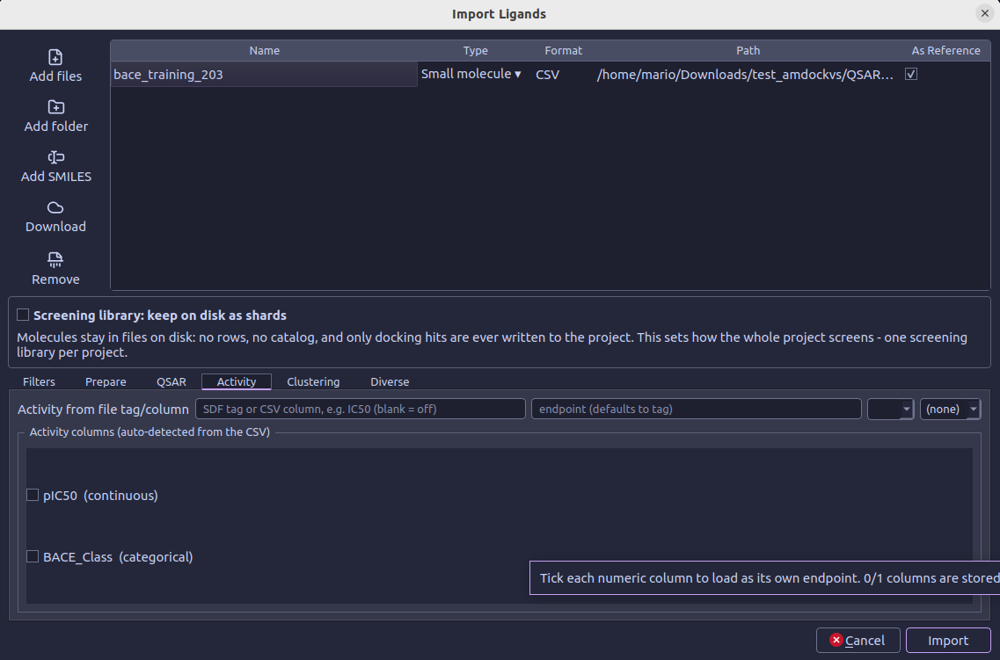
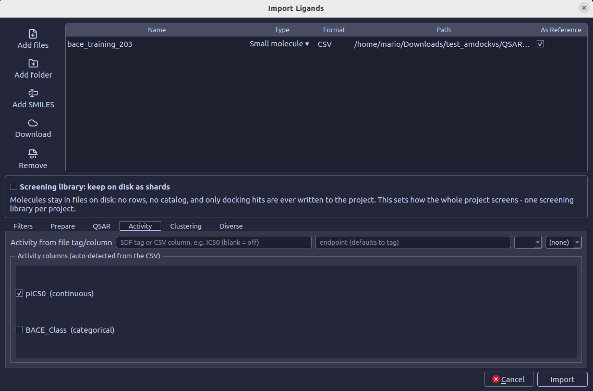
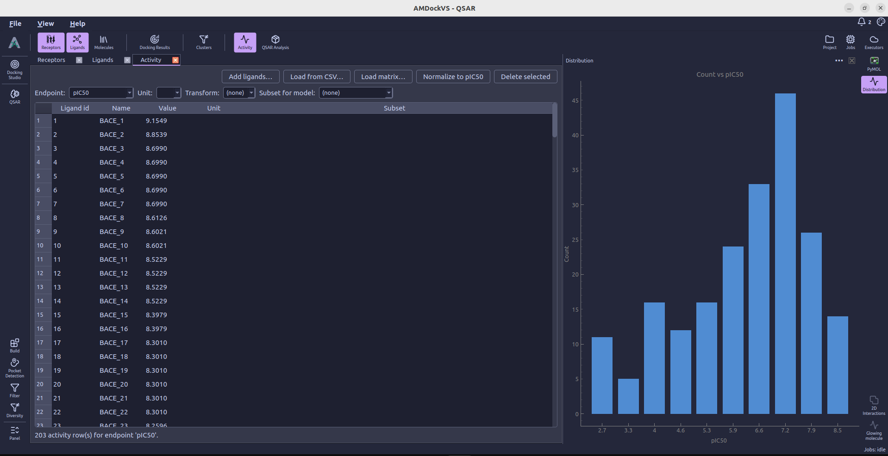
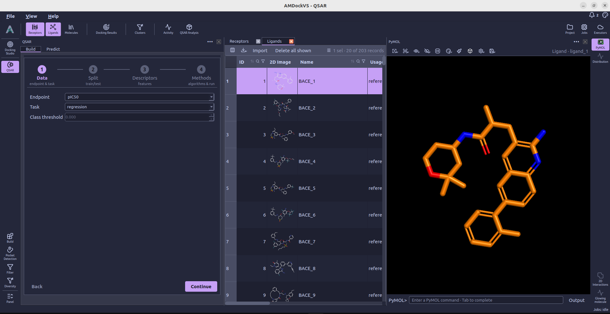
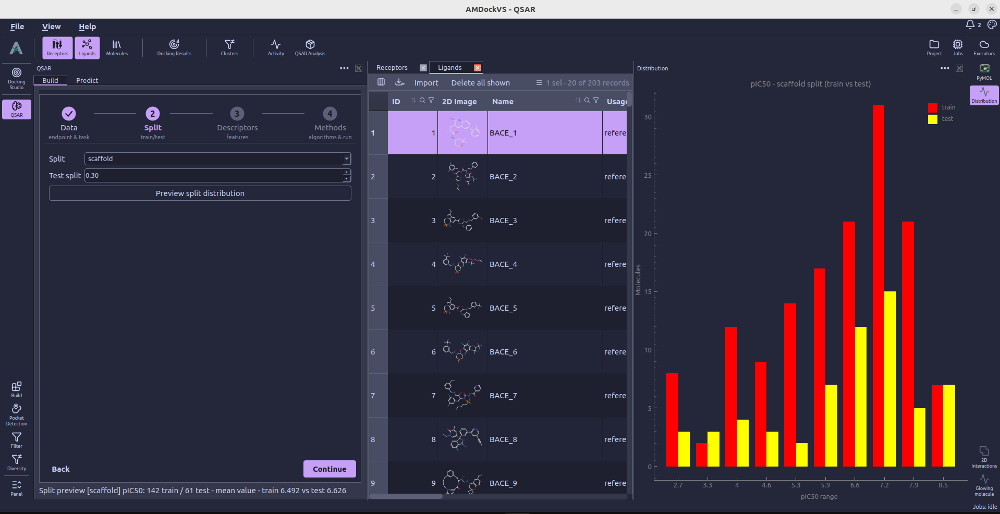
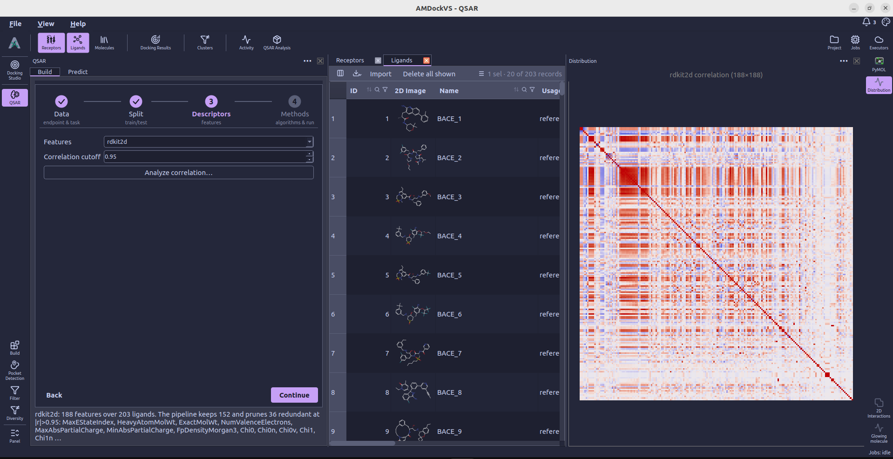
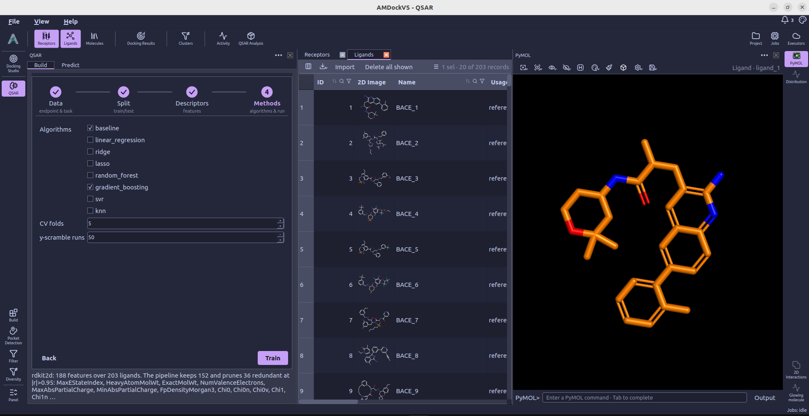
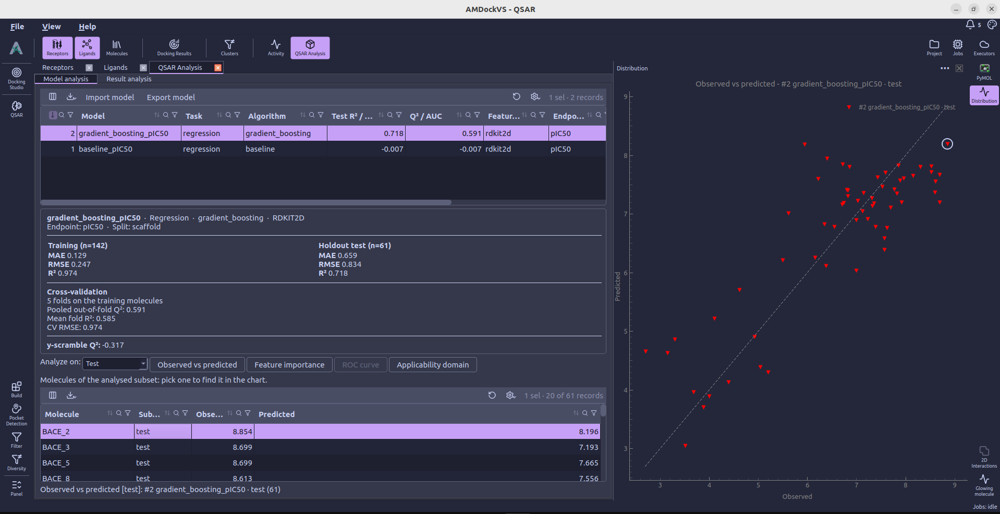
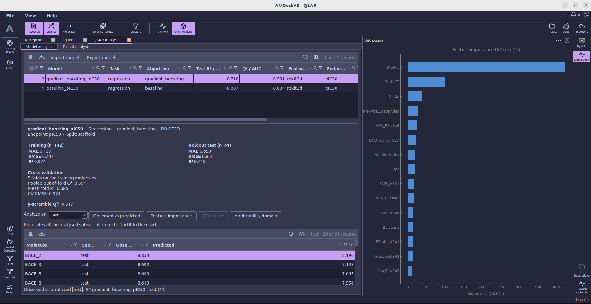
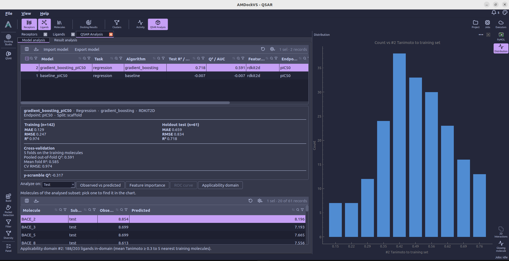

#  QSAR

The **QSAR** tool covers model building, review and prediction. Model building comprises four steps: data selection, train/test splitting, descriptor choice and algorithm selection. The **QSAR Analysis** view in the top catalog allows users to inspect the model metrics and prediction results.

## Typical workflow

  <ol class="tool-workflow__steps">
    <li>
      01
      <strong>Data</strong>
      Choose endpoint and task
    </li>
    <li>
      02
      <strong>Split</strong>
      Define training and test sets
    </li>
    <li>
      03
      <strong>Descriptors</strong>
      Choose molecular features
    </li>
    <li>
      04
      <strong>Methods</strong>
      Select algorithms and train
    </li>
  </ol>
  
↳<strong>QSAR Analysis</strong>Review model metrics

After reviewing a model, use **QSAR → Predict** to score ligands and inspect
their predictions in **QSAR Analysis → Result analysis**.

## 0. Import ligands and activities {#import}

Before building a model, import the molecular structures and their measured
activities through the **Ligands** catalog. For a CSV, include a SMILES column
and one or more numeric/categorical activity columns, with each row containing a compound
and its measurements.

For example, a CSV can use the following layout. These five entries are from
the [MoleculeNet BACE dataset](https://deepchemdata.s3-us-west-1.amazonaws.com/datasets/bace.csv):

| smiles                                             | name     | pIC50     | BACE_Class |
|----------------------------------------------------|----------|-----------|------------|
| `n1ccc2c(cccc2)c1N`                                | BACE_202 | 3         | 0          |
| `n1c2c(ccc1N)cccc2`                                | BACE_203 | 3         | 0          |
| `O=C1NC(=NC(=C1)CCC)N`                             | BACE_205 | 2.6989701 | 0          |
| `O=C(NC1CCCCC1)CCc1cc2cc(ccc2nc1N)-c1ccccc1C`      | BACE_89  | 7.1307683 | 1          |
| `Fc1ccc(NC(=O)c2ncc(cc2)C#N)cc1[C@]1(N=C(OCC1)N)C` | BACE_78  | 7.2923999 | 1          |

Here, **smiles** supplies the molecular structure and **name** identifies the
compound. **pIC50** is a continuous endpoint for regression; **BACE_Class**
contains binary labels for classification (`0` = inactive, `1` = active).
Your file can contain either or both endpoint types, using column names that
describe your measurements. Save the data as a CSV with a header row, and
select the activity columns during import as described below.

1. Open **Ligands → Import...**, select **Add files**, and choose the input file.
2. **Tick As Reference for each file containing activity measurements.** This
    enables the **Activity** tab below the file table and allows its measurements
    to be imported. Reference compounds are stored as project rows, even when
    screening-library sharding is enabled. Include both active and inactive
    compounds; the reference mark does not indicate an activity class.

    

3. **Activity** should open automatically when the user ticks **as Reference**.
    Under **Activity columns (auto-detected from the CSV)**,
    tick the columns to import as endpoints. For example, select
    **pIC50 (continuous)** for regression and **BACE_Class (categorical)** for
    binary classification. The detected columns are unchecked by default;
    tick the required measurements explicitly and leave unrelated numeric
    columns unchecked.
4. When using the detected-column checkboxes, leave **Activity from file
    tag/column** blank. For values already expressed as pIC50, leave the
    transform at **(none)**; do not convert them again or assign concentration
    units such as nM. To import a single SDF property or table column instead,
    enter its name under **Activity from file tag/column** and configure its
    endpoint, unit and transform as needed.

    

5. Select **Import** and follow progress in the [Jobs monitor](jobs_monitor.md).
    Once the job finishes, open **Activity** from the top toolbar and check
    that the endpoints and measurements are present.

    

    !!! important "As Reference and activity columns are both required"

        For a CSV imported through the column checkboxes, marking the file **As
        Reference** enables activity import, but does not select any columns.
        Without selecting the activity columns, the molecules can be imported
        without the measurements needed to train a model.

See [Ligands](ligands.md#activity) for more detail on activity import. Once the
data are available, open **QSAR → Build** to follow the four model setup steps
below.

## 1. Choose data {#data}

In **Data**, choose the activity endpoint (target variable) and set the task to regression or
classification. A continuous endpoint can be converted to classes with a
threshold; categorical endpoint labels are used directly.

## 2. Split the data {#split}

In **Split**, choose a holdout test fraction and a splitting method. The
available methods include random, stratified, scaffold, Butina and MaxMin
splits. Use **Preview split distribution** to inspect the train and test
distribution before training.

## 3. Choose descriptors {#descriptors}

In **Descriptors**, choose RDKit 2D descriptors or ECFP4 fingerprints. RDKit
descriptors can be pruned by a correlation cutoff; ECFP4 exposes the
fingerprint radius and bit count. Missing features are calculated as part
of the training jobs.

## 4. Select methods and train {#methods}

In **Methods**, select one or more supported algorithms to compare, then set
cross-validation folds and optional y-scramble runs. Select **Train** to
submit the model job.

Training jobs appear in the [Jobs monitor](jobs_monitor.md). After submission,
AMDockVS opens **QSAR Analysis → Model analysis**, where the models become
available as training completes.

## Analyze models

**Model analysis** lists trained models and summarizes their task, algorithm,
feature type, endpoint, split and reported metrics. Select a model to review
its training, holdout-test and cross-validation results. Depending on task and
model type, the analysis tools include observed-versus-predicted plots, ROC
analysis, feature importance and applicability-domain checks. Selecting a
molecule in the model’s analyzed subset links it to the corresponding point in
the chart.

=== "Observed vs. Predicted"

    

=== "Feature importance"

    

=== "Applicability domain"

    

## Predict

!!! failure "Under construction"

    The QSAR prediction workflow is under construction. The following description
    is a placeholder for the final workflow.

In **QSAR → Predict**, tick one or more saved models and choose how to score
the project’s ligands. **Predict all ligands** submits prediction jobs for
the selected models. For a screening library stored as shards, use **Predict
shards**; scores remain associated with the shards until you choose **Promote
top...** to add the best-scoring molecules from one model as ligand rows.

After prediction, the application opens **QSAR Analysis → Result analysis**
for that model. Predictions can be reviewed in the results table and filtered
by selecting a top N or a value cutoff. **Use as selection** applies the kept
ligands as the global ligand selection. **Exclude the rest** marks the other
scored ligands as excluded; they remain in the project and can be recovered
through Filter.

**Result analysis** shows a selected model’s predictions, confidence and
applicability-domain similarity for scored ligands. Selecting a row can
highlight that molecule in the 3D viewer when the model uses ECFP4
fingerprints. The applicability-domain value is the mean Tanimoto similarity
to the model’s nearest training molecules; a low value flags a prediction as
outside the configured domain threshold.

The programmatic interface for endpoints, model training and prediction is
documented in the [QSAR section of the API guide](runtime_api.md#chemistry-and-qsar).
