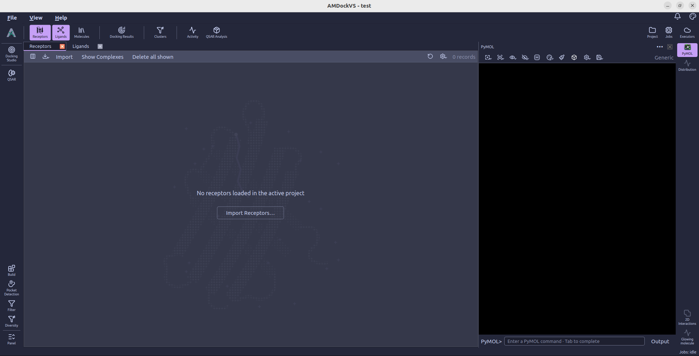
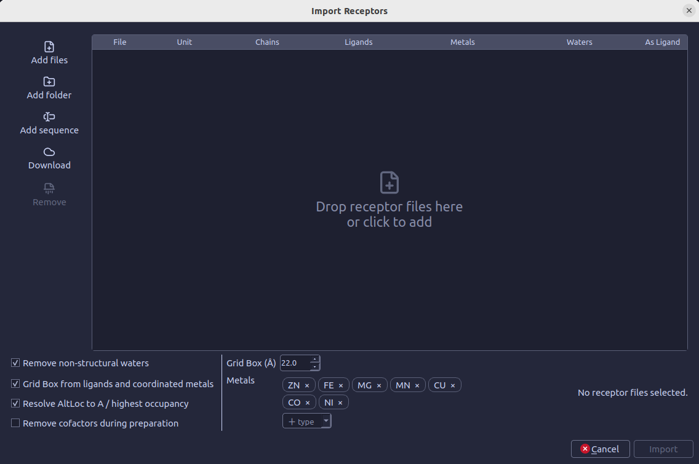
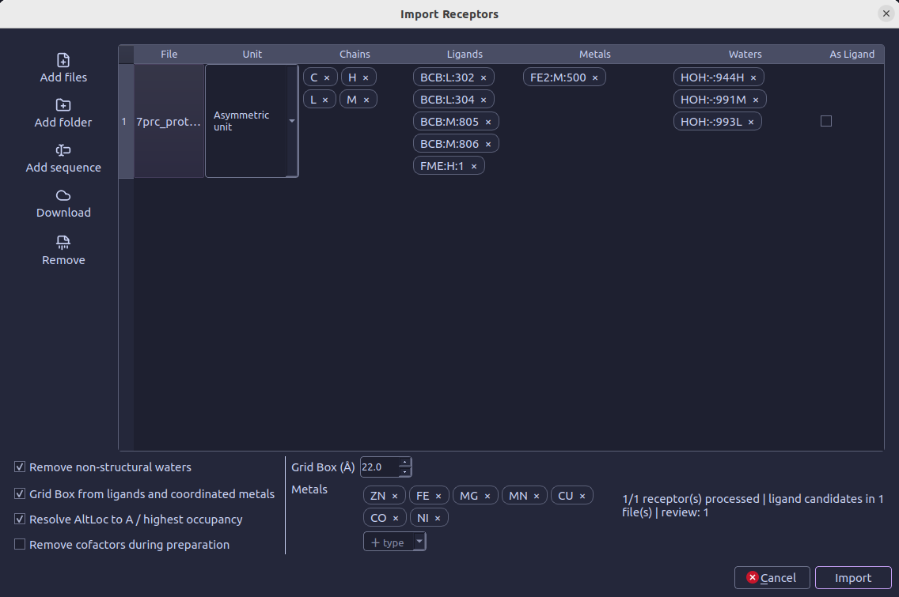

#  Receptors

The **Receptors** catalog lists the protein structures in the active project.
Select **Import Receptors...** in that catalog, or choose **File → Import Receptors...**, to
open the receptor import panel. This guide describes the panel’s input actions,
per-structure review table and import options.

## Add receptor structures

The toolbar beside the table provides these actions:

-  **Add files** — Choose one or more receptor structure files.
-  **Add folder** — Add supported files from a folder and its subfolders.
-  **Add sequence** — Paste FASTA or a bare amino-acid sequence. Use `:` to separate chains. Each FASTA record becomes a sequence input; it has no 3D coordinates until a structure is generated.
-  **Download** — Fetch structures or sequences by identifier from RCSB PDB (mmCIF), AlphaFold DB, ESM Metagenomic Atlas or UniProt. The dialog accepts PDB IDs, UniProt accessions or MGnify protein IDs, depending on the source.
-  **Remove** — Remove selected rows from the pending import list. This does not remove receptors already imported into the project.

You can also drop receptor files into the table. While the preview scan is
running, the add and remove controls are disabled. Structural preview is
available for PDB, mmCIF and PDBQT files. FASTA files can also be selected as
sequence inputs; they have no 3D coordinates until a structure is generated.

For downloaded files, **Keep the downloaded files** reuses them on a later
import. Otherwise, files are temporary and are deleted after the import job
finishes. The keep option is available when a project is open; temporary files
for that project can be reviewed in **Settings → Downloads**.

## Review each structure

After adding files, the panel scans them and shows one row per structure. The
preview table lets you make selections separately for each file:

| Column | What it controls |
| --- | --- |
| **File** | The selected file name. Downloaded files can be marked temporary. |
| **Unit** | Choose the asymmetric unit or one of the biological assemblies found in the structure. |
| **Chains** | Choose which chains to keep from the selected unit. By default, all available chains are kept. |
| **Ligands** | Choose co-crystal ligands to retain as reference ligands. With no narrower selection, all detected candidates are retained. |
| **Metals** | Choose which detected metal components to keep in the receptor. |
| **Waters** | Choose structural waters to retain. Non-structural waters are controlled by the global option below. |
| **As Ligand** | Also import this receptor as a general ligand, for cases such as docking a protein dimer. |

Changing the unit or selected chains updates the available ligand, metal and
water choices to match the parts of the structure that remain in scope.

## Set import options

The controls below the table apply to the import:

- **Remove non-structural waters** — Checked by default. Removes waters not
  classified as structural; structural waters are selected per file in the
  **Waters** column.
- **Grid Box from ligands and coordinated metals** — Checked by default.
  Creates binding-site boxes from the selected co-crystal reference ligands and
  configured coordinated metals. Turn it off to skip creating boxes during
  import.
- **Grid Box (Å)** — Set the side length of boxes created from the selected
  ligands or metals. The control accepts 8-40 Å in 1 Å steps; its initial value
  comes from the docking box-size setting.
- **Metals** — Select, add or reorder the coordinated metal types that can
  define grid-box centers. This global list is separate from the per-file
  **Metals** column, which controls whether detected metal components are
  retained in the receptor.
- **Resolve AltLoc to A / highest occupancy** — Checked by default. Resolves
  alternate atom locations by preferring location A, or the highest occupancy
  when A is unavailable.
- **Remove cofactors during preparation** — Off by default. Cofactors are
  removed during receptor preparation, not by this import option immediately.

## Start the import

Wait for the preview scan to finish, review the selections and options, then
select **Import**. The button becomes available after at least one file has
been added and any required preview scan is complete. For files within the
preview limit, the scan progress appears in the dialog footer. After submission,
follow the import job in the [Jobs monitor](jobs_monitor.md); the Receptors catalog opens as the
job is queued.

For batches larger than 50 files, per-file preview is disabled. The table then
shows file format and path instead of the per-structure selection columns, and
the import job handles the files without preview-derived binding-site boxes.
